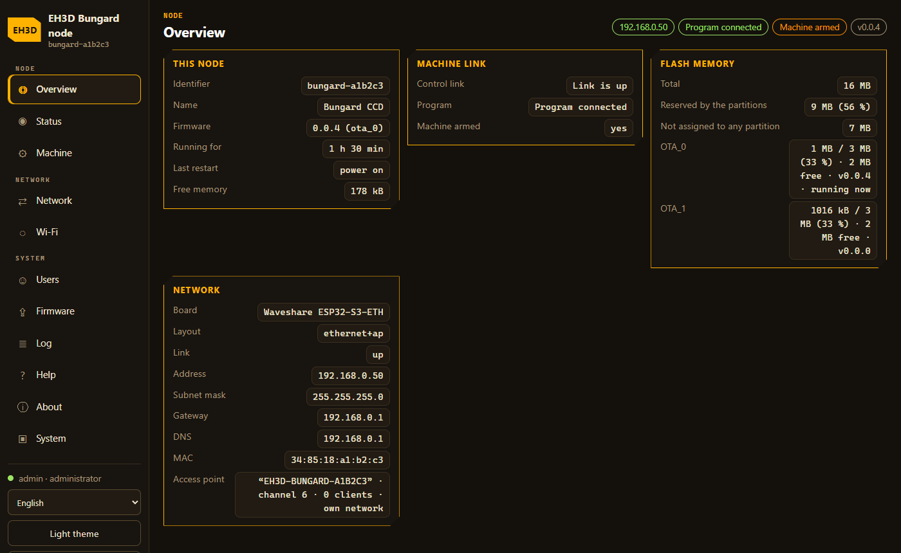
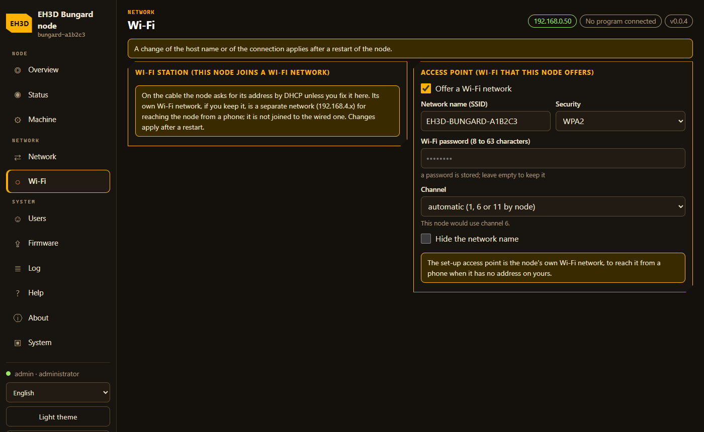
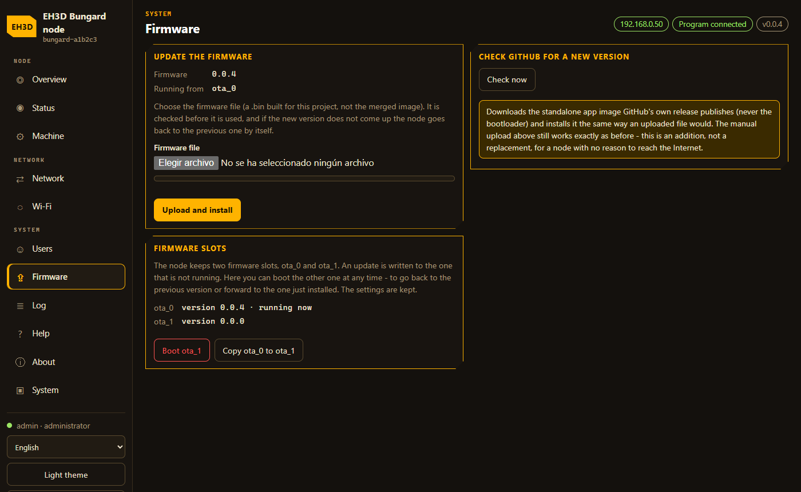
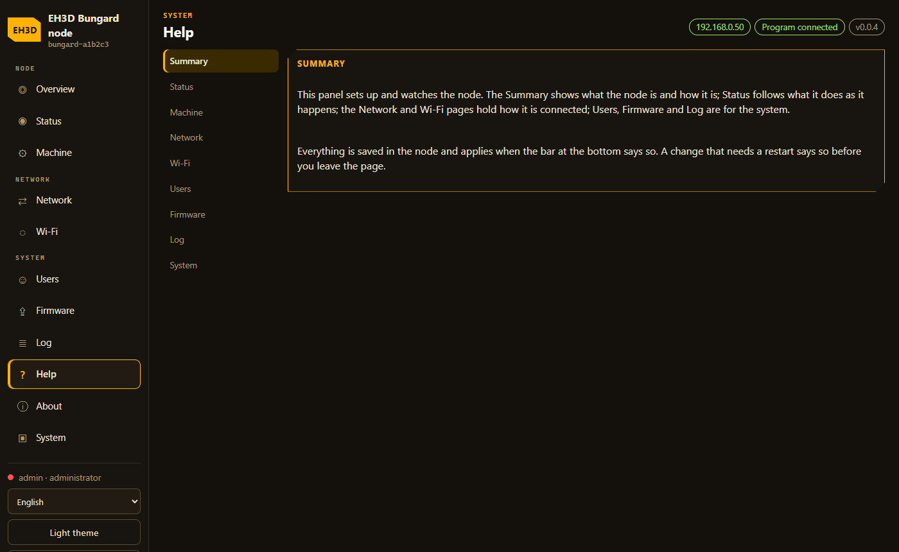

<p align="center">
  
</p>

# 📡 EH3D-NODE-BUNGARD

<p align="center"><a href="README.md">🇺🇸 English</a> | <a href="README_spa.md">🇪🇸 Español</a> | <a href="README_fra.md">🇫🇷 Français</a> | <a href="README_ita.md">🇮🇹 Italiano</a> | 🇩🇪 <b>Deutsch</b> | <a href="README_zho.md">🇨🇳 中文</a> | <a href="README_jpn.md">🇯🇵 日本語</a> | <a href="README_por.md">🇵🇹 Português</a></p>

### Ein ESP32-S3-Knoten, der im Gehäuse einer Bungard-CCD-Maschine sitzt, am RS-232-Anschluss ihrer Steuereinheit hängt und die EH3D-Programme die Maschine über Ethernet oder WLAN steuern lässt, mit den Lampen der Maschine und dem Spindelantrieb auf derselben Platine

<p align="center">
  
  
  
  
  
</p>

---

**Ehrlichkeitscheck - was heute tatsächlich läuft:** Firmware in C++17 für den ESP32-S3 (ESP-IDF 5.5), das den RS-232-Anschluss der Steuereinheit einer Bungard-CCD-Maschine zu einem Netzwerkanschluss macht: Ein Programm verbindet sich per TCP mit einem Zugriffstoken, schaltet die Maschine scharf und sendet die Bytes einer Bewegung, die der Knoten in eine Warteschlange legt und im eigenen Takt der Leitung ausgibt. Es liest außerdem die Lampen der Maschine (HOME X, Y und Z, ENABLE, TOOL), steuert eine Spindel über ein 0-10-V-Drehzahlsignal und Lauf-/Richtungsleitungen und hat ein Web-Panel mit Seitenmenü (37 Sprachen) für Einrichtung, Benutzer, Netzwerk, Update und die Maschineneinstellungen. Die Regeln der Verbindung und die Einstellungen sind auf einem Computer getestet (10 Testprogramme, 2.235 gezählte Prüfungen), und die Firmware baut für beide Platinen ohne Warnungen. **Sie wurde noch nicht auf eine Platine geflasht oder dort ausgeführt**, nichts wurde an eine Maschine angeschlossen, und die Trägerplatine, die RS-232-Wandler, Lampeneingänge und Spindelantrieb zusammenbringt, ist ein Entwurf auf Papier.

---

> **Stand von Sicherheit und IT-Sicherheit:** dies ist kein Sicherheitssystem (Safety). Ein falsch verdrahteter Knoten oder ein falsch eingestellter Spindelantrieb kann eine Maschine bewegen oder ein Werkzeug drehen lassen. Der Knoten lässt sich ohne Zugriffstoken nicht steuern, nimmt Bytes für die Maschine nur an, solange ein Programm ihn scharf geschaltet hat, und stoppt (Warteschlange geleert, Schrittmotortreiber und Spindel aus), wenn die Sitzung still wird oder die Verbindung abbricht (außer die optionale Einstellung, die ihn den gehaltenen Auftrag beenden lässt, ist an). Er sieht die Endschalter der Maschine nur über die Lampen und hat noch keinen eigenen Not-Aus (die Trägerplatine hat einen Platz für einen Tastereingang). Der Spindelantrieb liegt an Netzspannung: Verdrahte und stelle ihn nach dem Handbuch des Herstellers ein. Das Panel bewegt die Maschine nie und weigert sich, Einstellungen zu speichern, solange ein Programm die Maschine scharf hält. Das Projekt ist unabhängig: Es wird nicht von Bungard Elektronik hergestellt, empfohlen oder unterstützt, und Produktnamen erscheinen nur, um zu sagen, mit welchen Maschinen und Antrieben es arbeiten soll.

## 📋 Auf einen Blick

| | |
|---|---|
| Version | `0.0.4` |
| Reifegrad | Gerüst |
| Tests | 10 Host-Testprogramme (2.235 gezählte Prüfungen) |
| Technologie-Stack | C++17, ESP-IDF 5.5, ESP32-S3 |
| Auf echter Hardware | Nein: beide Firmware-Abbilder bauen, aber nichts wurde auf eine Platine geflasht oder dort ausgeführt, und nichts wurde an eine Maschine angeschlossen |

**Springe zu:** [Überblick](#-überblick) · [Architektur](#-architektur) · [Schnellstart](#-schnellstart) · [Tests](#-tests) · [Struktur](#-struktur-des-repositorys) · [Verwandte](#-verwandte-projekte)

## 🚦 Projektstatus

Jede Zeile ist ein Teil dieses Repositorys, und die Ampel sagt, wie weit er heute ist. Sie beruht auf dem, was das Repository zeigen kann (Tests, Builds, Läufe), nicht auf dem, was geplant ist.

🟢 Fertig und überprüft · 🟡 Funktioniert, mit bekannten Grenzen · 🟠 Teilweise fertig oder noch nicht überprüft · 🔴 Nicht gemacht oder funktioniert nicht

| Bereich | Stand | Was das hier bedeutet |
|---|---|---|
| Software | 🟡 | Die Firmware für den ESP32-S3 (ESP-IDF 5.5, C++17) baut für beide Platinen, Ethernet und WLAN, ohne Warnungen; kein Abbild wurde geflasht. |
| Tests | 🟡 | 10 Host-Testprogramme bestehen (`ctest`): 2.235 gezählte Prüfungen zu Verbindung, Einstellungen, Maschinenregeln und gemeinsamer Basis, dazu die Prüfung der Paneltexte (315 Zeilen in 8 Sprachen) und der Task-Stacks (10 Tasks). |
| Steuerverbindung | 🟡 | Das gerahmte Protokoll (CRC, Token-Anmeldung, Scharfschalten, Byte-Warteschlange, Stopp bei stiller Sitzung) ist von den Host-Tests abgedeckt; kein Programm hat mit einem echten Knoten gesprochen. |
| Web-Panel | 🟡 | Das Web-Panel (Seitenmenü, 37 Sprachen: Einrichtung, Maschine, Netzwerk, Benutzer, Update, Protokoll, System) hat geprüfte Texte und wird in einem Browser gegen eine Attrappe des Knotens erprobt; es wurde nie von einer Platine ausgeliefert. |
| Spindel und Lampen | 🟠 | Das 0-10-V-Drehzahlsignal, die Lauf- und Richtungsleitungen (kein Umkehren während des Drehens) und die fünf Lampeneingänge sind auf dem Host getestet; kein Spindelantrieb und keine Maschine wurden angeschlossen. |
| Updates | 🟠 | Das Hochladen in einen von zwei Firmware-Slots mit Rückfall und Bestätigung ist auf dem Host getestet; ein Update lief nie auf einer Platine. |
| Sicherheit | 🟡 | Einrichtungscode auf der USB-Konsole, Zugriffstoken, Benutzer und Rollen, optionales HTTPS und nichts Geheimes einkompiliert; er stoppt von selbst, wenn die Verbindung abbricht. Es gibt noch keinen Not-Aus-Eingang und keine unabhängige Prüfung. |
| Echte Hardware | 🔴 | Keine Platine hat diese Firmware ausgeführt, und die Trägerplatine mit RS-232-Wandler, Lampeneingängen und Spindelantrieb ist nur ein Entwurf auf Papier. |
| Dokumentation | 🟡 | README in acht Sprachen, das Protokoll, die Firmware, die Verdrahtung und der Entwurf der Trägerplatine. |

## 🎯 Überblick

* Die **Steuerverbindung** (TCP, standardmäßig Port 5800): ein gerahmtes Protokoll mit CRC, eine Anmeldung mit Zugriffstoken, das Scharfschalten, eine Byte-Warteschlange für die Steuereinheit und ein Stopp, wenn die Sitzung still wird oder abbricht. Das Programm sendet die Bytes einer Bewegung bereits mit Abständen, und die UART des Knotens legt sie exakt auf die Leitung, was ein USB-Seriell-Adapter bei hoher Geschwindigkeit nicht kann.
* Die **serielle Leitung zur Steuereinheit**: 38400 Baud 8N1 über einen MAX3232, mit den Leitungen DTR, DCD und RI des Handshakes. Die Pins und ob der Transceiver die Leitungen invertiert, sind Einstellungen.
* Die **Lampen**: HOME X, HOME Y, HOME Z, ENABLE und TOOL werden über einen Pufferttransistor gelesen, im Status und im Panel angezeigt, und eine Anfrage kann den Knoten den Rest einer Suche verwerfen lassen, sobald eine Achse in Referenz ist, sodass das Programm die Home-Leitung nicht mehr mitten im Datenstrom lesen muss.
* Die **Spindel**: ein Drehzahl-PWM für einen 0-10-V-Wandler (standardmäßig 24000 U/min bei vollem Signal, für einen Frequenzumrichter wie den Huanyang HY02D223B) und Leitungen für Vorwärts-/Rückwärtslauf, ohne Richtungswechsel während der Drehung oder gleich nach dem Stillstand und mit Stopp, wann immer die Maschine gestoppt wird.
* Das **Panel** (HTTP und HTTPS, 37 Sprachen, das Menü links auf einem breiten Bildschirm und oben auf einem Telefon): Ersteinrichtung mit einem Code auf der USB-Konsole, Benutzer, Ethernet oder WLAN, die Steuerverbindung, die RS-232-Pins, die Lampen und die Spindel, ein Protokoll und Updates durch Hochladen in einen von zwei Firmware-Slots mit Rückfall. Nichts Geheimes ist in das Abbild einkompiliert.
* Der **Selbstschutz**: ein Wächter, der Tasks und Speicher beobachtet, ein Tor an der Tür des Panels bei Speichermangel und die Bestätigung eines neuen Abbilds, sobald der Knoten erreichbar ist.
* Die **Platinen**: das Waveshare ESP32-S3-ETH (W5500-Ethernet) und ein ESP32-S3-WROOM-1 N16R8 (WLAN), je ein Abbild. Der Entwurf der Trägerplatine (100 x 100 mm) steht in `docs/BOARD.md`.
* Die **Maschinen**: die Bungard CCD MTC und CCD/2 MTC, mit der seriellen Steuereinheit der DOS-Software 4.6. Die beiden ATC-Modelle sind nicht abgedeckt; die XL-Modelle und spätere Maschinen haben eine eigene moderne Steuereinheit.
* Das **autonome Beenden** (standardmäßig aus, eine Einstellung): Wenn das Programm oder der Server wegfällt, führt der Knoten die bereits in seiner Warteschlange liegenden Bytes bis zum Ende aus - die eingereihten Spindelbefehle eingeschlossen - und schaltet dann Spindel und Treiber ab. Die Warteschlange liegt im externen RAM (bis 4 MB, Minuten an Bewegung), ein Zeitlimit beendet sie, ebenso ein Abort und die Stopptaste des Panels. **Geplant, noch nicht gebaut**: ein Tastereingang für einen physischen Stopp.

## 🧩 Rolle in EH3D

EH3D-NODE-BUNGARD ist die letzte Stufe zwischen den EH3D-Programmen und der Maschine: EH3D-DRILLPRO und EH3D-ROUTEPRO verbinden sich heute mit ihm, und EH3D-SERVER steht für die anderen Clients davor. Es ist der erste Knoten der EH3D-Familie, und seine Einstellungen, sein Panel und seine Update-Mechanik sollen mit den folgenden Knoten geteilt werden (die gemeinsame Basis liegt in EH3D-COMMON).

## 🏛️ Architektur

<p align="center">
  
</p>

Wie die Teile dieses Repositorys zusammenpassen: wer es nutzt, was es enthält und wovon es abhängt. Das Bild wird aus `docs/architecture.json` gezeichnet und gegen den Code geprüft.

## 🖼️ Screenshots

<p align="center">
  
</p>

<p align="center"><em>Die Seite Übersicht: der Knoten, seine Hardware, seine Uhr, sein Flash mit den zwei Firmware-Slots und sein Netz.</em></p>

<p align="center">
  
</p>

<p align="center"><em>Die Seite Status im Forge-Design der anderen EH3D-Programme.</em></p>

<p align="center">
  
</p>

<p align="center"><em>Die Seite Maschine: die Steuerverbindung, die RS-232-Pins, die Lampen, die Spindel und das Zugriffstoken.</em></p>

<p align="center">
  
</p>

<p align="center"><em>Die WLAN-Seite: das Netz, dem der Knoten beitritt, und bis zu drei Ersatznetze für den Fall des Verlusts.</em></p>

<p align="center">
  
</p>

<p align="center"><em>Die Seite Firmware: das Update von GitHub, das Hochladen einer Datei und die zwei Slots mit dem Kopieren des einen auf den anderen.</em></p>

<p align="center">
  
</p>

<p align="center"><em>Die Hilfeseite: ein Thema für jede Seite des Panels.</em></p>

## ✨ Funktionen

* **Ein Panel mit Seitenmenü:** sieben Seiten (Status, Maschine, Netzwerk, Benutzer, Firmware, Protokoll, System), das Menü links auf einem breiten Bildschirm und oben auf einem Telefon, mit Sprache, Theme und Abmelden daneben.
* **Ein Abbild, keine Geheimnisse:** Alles, was sich von Knoten zu Knoten unterscheidet, ist ein im Panel bearbeitetes Einstellungsdokument im Flash; kein Passwort, Token oder Netzwerk ist einkompiliert.
* **Bytes mit dem richtigen Timing:** Das Programm legt jeden Schritt fest, und die UART des Knotens sendet die Bytes im eigenen Takt der Leitung, was ein USB-Adapter nicht halten kann.
* **Referenz live gesehen:** Die fünf Lampen werden gelesen, und eine Anfrage verwirft den Rest einer Suche, sobald eine Achse in Referenz ist.
* **Spindel mit Leitplanken:** Drehzahl auf die Höchstdrehzahl begrenzt, für die der Knoten gebaut wurde, kein Umkehren während des Drehens oder gleich nach dem Stillstand, Stopp zusammen mit der Maschine.
* **Update mit Rückfall:** Ein Abbild kommt in den nicht laufenden Slot und steht unter Bewährung, bis der Knoten erreichbar ist; der Bootloader geht zurück, wenn er es nicht ist.
* **Sorgt für sich selbst:** Ein Wächter beobachtet Tasks und Speicher, und ein Knoten ohne Adresse nach neunzig Sekunden öffnet das Einrichtungsnetz wieder, damit er nicht unerreichbar bleibt.
* **Das Panel des Knotens wie bei den Knoten von A.R.M.O.R.:** ein Menü in Gruppen (Knoten, Netzwerk, System) mit Sprache und Abmelden am Fuß; eine Übersicht (der Knoten, seine Hardware, seine Uhr, sein Flash und sein Netz), eine WLAN-Seite mit bis zu drei Ersatznetzen, die der Knoten probiert, wenn das Hauptnetz verloren geht, eine vollständige Hilfe und eine Über-Seite und, unter Firmware, das Update von GitHub (es sucht das neueste Release des Projekts, prüft dessen SHA-256 und installiert es im anderen Slot), der Wechsel zwischen den beiden Slots und das Kopieren des laufenden in den anderen.
* **37 Sprachen:** das Web-Panel des Knotens spricht Englisch, Spanisch, Italienisch, Deutsch, Französisch, Portugiesisch, Chinesisch, Japanisch, Bulgarisch, Kroatisch, Tschechisch, Dänisch, Niederländisch, Estnisch, Finnisch, Griechisch, Ungarisch, Irisch, Lettisch, Litauisch, Maltesisch, Polnisch, Rumänisch, Slowakisch, Slowenisch, Schwedisch, Norwegisch, Isländisch, Ukrainisch, Russisch, Serbisch, Albanisch, Katalanisch, Galicisch, Baskisch, brasilianisches Portugiesisch und kanadisches Französisch. Die Wörter der 29 Sprachen nach den ersten acht stammen vom Modell und warten auf die Durchsicht durch Muttersprachler; ein fehlender Text wird auf Englisch gezeigt.

## 🔒 Sicherheit und Schutz

| Bedrohung | Abwehr |
|---|---|
| Jemand im Netz steuert die Maschine | Die Verbindung lehnt alles außer Hello ab, bis das Zugriffstoken (8 bis 64 druckbare Zeichen) stimmt; ein Knoten ohne Token lehnt Steuerung ab, außer die Prüfstandseinstellung `allow_open` ist an (standardmäßig aus); ein Programm zur Zeit |
| Ein Programm, das die Maschine aus Versehen bewegt | Bytes werden nur im scharfen Zustand angenommen und nur, wenn der ganze Rahmen in die Warteschlange passt; ein Spindelbefehl wird auf die Höchstdrehzahl gekappt und abgelehnt, wenn er eine drehende Spindel umkehren würde |
| Ein herausfallendes Kabel oder ein Programm, das mitten in der Bewegung stirbt | Eine scharfe Sitzung, die `idle_ms` (standardmäßig 3000 ms) still ist oder deren Verbindung abbricht, leert die Warteschlange und sendet das Treiber-aus-Byte `0xC0`; die Spindel geht auf 0 U/min |
| Jemand erreicht das Panel | Der erste Administrator wird mit einem Einrichtungscode angelegt, der nur auf der USB-Konsole erscheint; zwei Rollen (Administrator, Betrachter); ein falsches Passwort wird ausgebremst, und eine Quelladresse, die weiter scheitert, wird eine Zeit lang gesperrt; HTTP, HTTPS oder beides |
| Geheimnisse in der Firmware oder im Repository | Nichts Geheimes ist einkompiliert: Token, Netzwerk und Pins sind Einstellungen im Flash; das Token ist im Panel und in der API nur schreibbar |
| Ein Einstellungsschreibvorgang, der eine Bewegung stört | Solange ein Programm die Maschine scharf hält, weigert sich das Panel, Einstellungen zu speichern (HTTP 409 `machine_armed`), und verschiebt einen Neustart |
| Eine falsche Pinbelegung | Pins, die die Platine reserviert (Flash, PSRAM, USB, der Ethernet-Chip), werden abgewiesen, und kein Pin darf zwei Aufgaben haben |
| Ein fehlerhaftes Firmware-Abbild | Ein Abbild eines anderen Projekts oder ein leerer Slot wird abgewiesen; ein neues Abbild steht unter Bewährung, und der Bootloader geht zum vorherigen zurück, wenn das Panel nicht startet oder der Knoten binnen fünf Minuten nicht erreichbar ist |
| Ein Knoten, dem der Speicher ausgeht oder der hängt | Ein Wächter beobachtet Tasks und internen Speicher und startet neu, ohne eine Schleife zu bilden; ein Tor an der Tür des Panels bei Speichermangel |
| Jemand hat den Knoten in der Hand | Wer BOOT acht Sekunden in den ersten dreißig nach dem Einschalten hält, löscht Einstellungen und Benutzer (physischer Zugriff ist absichtlich ein Reset) |

**Was nicht abgewehrt wird:** Der Knoten hat noch keinen Not-Aus-Eingang und sieht die Endschalter nur über die Lampen; das Update ist nicht signiert (das Update von GitHub prüft den SHA-256, den das Release veröffentlicht, über HTTPS und nur auf Wunsch eines Administrators; ein Signaturschlüssel fehlt noch); das selbst erzeugte Zertifikat des HTTPS-Panels lässt einen Browser warnen; nichts lief auf einer Platine, und es gab keine unabhängige Prüfung. Melde eine Schwachstelle privat (siehe [SECURITY.md](SECURITY.md)).

## 🔌 Schnittstellen

| Schnittstelle | Was es ist | Wo |
|---|---|---|
| Steuerverbindung | TCP, standardmäßig Port 5800: Rahmen `0xB5, Typ, Länge, Nutzlast, CRC-16`, Hello mit dem Token, Arm, Write, Abort, Ping, StopOnHome, Spindle; der Knoten antwortet mit Info, Status (alle 200 ms), Rx, HomeSeen und Error | [docs/PROTOCOL.md](docs/PROTOCOL.md), `core/frame.hpp`, `main/link_server.cpp` |
| Web-Panel | HTTP auf Port 80 und HTTPS auf Port 443 (der Modus ist eine Einstellung), 37 Sprachen, API unter `/api/v1/` (`GET`/`PUT /api/v1/machine`, `GET /api/v1/machine/status` und die gemeinsamen Routen der Basis) | [docs/NODE_FIRMWARE.md](docs/NODE_FIRMWARE.md), `main/web_server.cpp`, `panel/` |
| RS-232 zur Steuereinheit | UART mit 38400 Baud 8N1 über einen MAX3232, mit DTR (aus), DCD und RI (ein) | [docs/WIRING.md](docs/WIRING.md), `main/central_uart.cpp` |
| Lampen | HOME X, HOME Y, HOME Z, ENABLE und TOOL, fünf Eingänge über einen Pufferttransistor | [docs/WIRING.md](docs/WIRING.md), `main/lamps.cpp` |
| Spindel | ein Drehzahl-PWM für einen 0-10-V-Wandler und Leitungen für Vorwärts-/Rückwärtslauf | [docs/BOARD.md](docs/BOARD.md), `main/spindle.cpp` |
| USB-Konsole | zeigt den Einrichtungscode und nimmt Improv-WLAN über seriell an | `main/improv_serial.cpp` |
| Einrichtungsnetz | Der Knoten öffnet das WLAN `EH3D-SETUP-xxxxxx`, solange er keinen Benutzer hat | [docs/NODE_FIRMWARE.md](docs/NODE_FIRMWARE.md) |

## ⚙️ Konfiguration

Alles ist eine Einstellung im Flash, die im Panel bearbeitet wird (Seite Maschine), sodass ein Abbild für jeden Knoten genügt. Die Werte unten sind die eines Knotens, der nie konfiguriert wurde; ein Wert außerhalb des Bereichs wird beim Speichern abgewiesen.

| Einstellung | Standard | Bereich | Was sie bewirkt |
|---|---|---|---|
| `machine.link.port` | 5800 | 1024 bis 65535 | der TCP-Port der Steuerverbindung |
| `machine.link.token` | keines | 8 bis 64 druckbare Zeichen; nur schreibbar | das Zugriffstoken; ohne eines lässt sich der Knoten nicht steuern |
| `machine.link.allow_open` | aus | an oder aus | eine Prüfstandseinstellung: Steuerung ohne Token annehmen |
| `machine.link.idle_ms` | 3000 | 200 bis 60000 | wie lange eine scharfe Sitzung still sein darf, bevor der Knoten stoppt |
| `machine.link.queue_bytes` | 262144 | 1024 bis 4194304 | die Byte-Warteschlange für die Steuereinheit im externen RAM |
| `machine.link.finish_on_loss` | aus | an oder aus | den bereits in der Warteschlange liegenden Auftrag beenden, wenn das Programm wegfällt |
| `machine.link.max_drain_s` | 600 | 10 bis 3600 | die höchste Zahl von Sekunden, die der Knoten dann allein weitermachen darf |
| `machine.uart.*` | tx 17, rx 18, dtr 15, dcd 16, ri 21, cts und dsr nicht verdrahtet; Transceiver invertiert | ein freier Pin der Platine, oder -1 wo optional | die Pins der seriellen Leitung |
| `machine.lamps.*` | HOME X 1, Y 2, Z 7, ENABLE 8, TOOL 38; aktiv low | ein freier Pin | die fünf Lampeneingänge |
| `machine.spindle.max_rpm` | 24000 | 0 bis 65535 (0: kein Spindelausgang) | die Drehzahl bei vollem Signal |
| `machine.spindle.pwm_hz` | 2000 | 100 bis 40000 | die Frequenz des Drehzahlsignals |
| `machine.spindle.reverse_delay_ms` | 3000 | 0 bis 60000 | wie lange die Spindel stillgestanden haben muss, bevor sie andersherum drehen darf |
| `web.mode` | `both` | `http`, `both` oder `https` | ob das Panel auf Port 80, auf 443 oder auf beiden ausgeliefert wird |

Auch die Pins der Spindel (PWM 4, vorwärts 5, rückwärts 6) sind Einstellungen. Die Einstellungen, die jeder Knoten hat (Name, Zugang, Access Point, Adresse, Uhr, Sprache, periodischer Neustart), stehen in der Basis und sind in [docs/NODE_FIRMWARE.md](docs/NODE_FIRMWARE.md) beschrieben.

## 🚀 Schnellstart

Du brauchst einen C++17-Compiler und CMake für die Host-Tests sowie ESP-IDF 5.5 (oder Docker) für die Firmware.

```bash
build.bat            # the host tests (Windows)  -  ./build.sh on Linux
tools/build_node.sh s3-eth      # or s3-wifi: the firmware, in the ESP-IDF container
python -I tools/ci_validate.py
```

`tools/build_node.sh s3-eth` (oder `s3-wifi`) baut ein Abbild im ESP-IDF-Container; unter Windows macht ein installiertes ESP-IDF 5.5.5 dasselbe. Das Abbild `dist/eh3d-node-bungard-<Version>-<Platine>-complete.bin` gilt für EINE Platine: Flashe es an Adresse 0 mit `python -m esptool --chip esp32s3 -p COMx write_flash 0x0 <Abbild>`. Tritt dann dem WLAN `EH3D-SETUP-xxxxxx` bei, das der Knoten öffnet, öffne `http://192.168.4.1/` und gib den Einrichtungscode ein, den der Knoten auf seiner USB-Konsole zeigt; Zugriffstoken, Netzwerk und Pins werden im Panel eingestellt. Dieser Weg wurde auf einer echten Platine noch nicht gegangen.

## 🧪 Tests

Die Host-Tests (`build.bat` oder `./build.sh`, dann `ctest`) sind 10 Programme, und alle bestehen: `core_tests` (104 Prüfungen: die Rahmen und die Sitzungsregeln), `test_base` (382), `test_clock` (gibt ok aus), `test_settings` (392), `test_machine` (75), `test_shared` (627) und `test_shared_eth` (629, das Profil der Ethernet-Platine) - 2.235 gezählte Prüfungen - sowie `panel_text` (315 Zeilen in 8 Sprachen, 265 verwendete Schlüssel, 36 Firmware-Fehlercodes mit Text) und `task_safety` (10 Tasks, keine große Kopie der Einstellungen auf einem kleinen Stack). Sie decken CRC und den Decoder ab, der sich nach Beschädigung neu synchronisiert, Token-Anmeldung, Scharfschalten, den Stopp bei Stille, die Spindelregeln (Begrenzung, kein Umkehren, Verzögerung), die Einstellungen und ihre Bereiche, Pin-Konflikte und reservierte Pins, Benutzer und Sitzungen, den Netzplan, die Uhr und JSON. Das Panel wurde außerdem in einem Browser gegen `tools/panel_mock.mjs` erprobt, einen Ersatzknoten, der es ohne Platine ausliefert. Die CI führt `python -I tools/ci_validate.py` und die Host-Tests unter Linux mit Warnungen als Fehlern aus. Das Bauen der beiden Firmware-Abbilder (ESP-IDF 5.5.5) geschieht von Hand und gehört nicht zur CI; nichts läuft auf einer Platine.

## 🏗️ Build und Veröffentlichung

Die Version steht in `eh3d.project.json` und im Build, und jede Version hat ihren Eintrag in [CHANGELOG.md](CHANGELOG.md). `build.sh` / `build.bat` bauen und führen die Host-Tests aus, `test.sh` / `test.bat` führen nur die Tests aus, jeweils in einem Live-Panel; keines ändert die Version. Die Firmware-Abbilder entstehen mit `tools/build_node.sh` (oder ESP-IDF 5.5.5 unter Windows) und heißen `eh3d-node-bungard-<Version>-<Platine>-{app,complete}.bin`. Es wurde noch kein Release veröffentlicht und kein Abbild geflasht. Das Update von GitHub ist gebaut und lief nie auf einer Platine gegen das echte GitHub; die Releases sind nicht signiert, es vertraut also dem Hash, den sie veröffentlichen.

## 🩺 Fehlerbehebung

| Symptom | Was tun |
|---|---|
| Der Knoten ist nicht erreichbar | Ein Knoten ohne Adresse nach neunzig Sekunden öffnet das Einrichtungsnetz `EH3D-SETUP-xxxxxx` wieder; tritt ihm bei und stelle den Zugang im Panel ein. |
| Der Einrichtungscode ist verloren | Er erscheint nur auf der USB-Konsole, alle fünfzehn Sekunden. Wer BOOT acht Sekunden in den ersten dreißig nach dem Einschalten hält, löscht Einstellungen und Benutzer und beginnt die Einrichtung neu. |
| Die Verbindung antwortet mit Error 1 oder 2 | Nicht angemeldet oder falsches Token: Der erste Rahmen muss Hello mit dem im Panel gesetzten Zugriffstoken sein (Seite Maschine). |
| Error 3 oder 4 | Nicht scharf (zuerst Arm senden) oder die Warteschlange ist voll (warten, bis der Status Platz zeigt). |
| Error 7 | Die scharfe Sitzung war `idle_ms` lang still: Sende Ping, solange eine lange Bewegung in der Warteschlange liegt. |
| Error 9, 10 oder 11 | Die Spindel muss vor dem Umkehren stehen, stand zu kurz, um umzukehren, oder der Knoten beendet den gehaltenen Auftrag. |
| Das Panel verweigert das Speichern (409 `machine_armed`) | Ein Programm hält die Maschine scharf; entschärfe sie oder drücke die Stopptaste auf der Statusseite und speichere erneut. |
| Der Browser warnt vor dem HTTPS-Panel | Der Knoten erzeugt beim ersten Mal sein eigenes Zertifikat; nutze in einem vertrauenswürdigen Netz den Modus `http` oder `both`, oder akzeptiere das Zertifikat. |

## 📂 Struktur des Repositorys

<p align="center">
  
</p>

<details>
<summary>Textversion des Baums</summary>

```text
EH3D-NODE-BUNGARD/
├── core/
│   ├── frame.hpp session.hpp                    Rahmen und Sitzungsregeln
│   ├── byte_queue.hpp drain.hpp                 Byte-Queue, Auftragsende
│   ├── bungard_config.hpp                       Maschineneinstellungen, Pins
│   ├── node_settings.hpp auth.hpp               Einstellungen, Benutzer (Basis)
│   ├── netplan.hpp json.hpp                     Netzplan und JSON (Basis)
│   └── release_assets.hpp semver.hpp            welche Datei eines Releases das Image dieser Platine ist
├── main/
│   ├── app_main.cpp link_server.cpp             Start und Steuerverbindung
│   ├── central_uart.cpp lamps.cpp               serielle Leitung, Lampen
│   ├── spindle.cpp machine_api.cpp              Spindelausgänge, API
│   ├── web_server.cpp network.cpp               Panel-Server, Netz (Basis)
│   ├── node_store.cpp node_guard.cpp            Speicher, Wächter (Basis)
│   └── github_update.cpp entropy.cpp            das Update von GitHub und das Kopieren eines Slots
├── panel/
│   ├── index.html style.css                     die Seite und das Layout des Seitenmenüs
│   ├── app.js text.js                           die Seiten und die Texte in 37 Sprachen
│   └── locales/                                 die Wörter von 29 weiteren Sprachen, je eine Datei
├── tests/                                       Host-Tests von Verbindung, Einstellungen, gemeinsamer Basis und Paneltexten
├── docs/                                        Protokoll, Firmware, Verdrahtung, Platine
├── tools/                                       Build, Panel-Pack, Prüfungen, Ersatzknoten
├── CMakeLists.txt                               das ESP-IDF-Projekt
├── partitions.csv                               der Flash mit zwei Slots
├── sdkconfig.*                                  ESP-IDF-Einstellungen, Profile
├── images/                                      Banner und die Bilder von Architektur und Repository-Struktur
├── .github/                                     CI- und Release-Workflows, Vorlagen für Issues und Pull Requests
├── build.sh build.bat                           baut und führt die Host-Tests in einem Live-Panel aus
├── eh3d.project.json                            Manifest: Version, Rolle, Reifegrad und Build-Befehl
├── CHANGELOG.md                                 was sich in jeder Version geändert hat
├── SECURITY.md SUPPORT.md                       Schwachstellen melden und Fragen stellen
└── CONTRIBUTING.md CODE_OF_CONDUCT.md LICENSE   Mitwirken, Verhaltenskodex und Lizenz
```

</details>

## 🗺️ Roadmap und bekannte Grenzen

**Bekannte Grenzen heute**

* Nichts lief auf einer Platine: Kein Abbild wurde geflasht, keine Einrichtung an einem echten Knoten gemacht, kein Programm hat mit einem gesprochen, und nichts wurde an eine Maschine angeschlossen.
* Die Trägerplatine mit RS-232-Wandler, Lampeneingängen und Spindelantrieb ist ein Entwurf auf Papier (`docs/BOARD.md`).
* Der Knoten hat keinen Not-Aus-Eingang (die Trägerplatine hat einen Platz für einen Taster) und sieht die Endschalter nur über die Lampen.
* Das Update von GitHub ist gebaut und lief nie auf einer Platine gegen das echte GitHub; die Releases sind nicht signiert, es vertraut also dem Hash, den sie veröffentlichen. Das Panel wurde in einem Browser gegen einen Ersatzknoten angesehen, nicht von einer Platine ausgeliefert.
* Das Beenden des gehaltenen Auftrags lief nie auf einer Platine; seine Regeln sind auf einem Computer getestet.
* Vorgesehen sind nur die Maschinen Bungard CCD MTC und CCD/2 MTC; die ATC-Modelle sind nicht abgedeckt.

**Als Nächstes**

* Auf jede Platine ein Abbild flashen, die erste Einrichtung machen und die Verbindung gegen die Rust-Bibliothek prüfen.
* Die Trägerplatine zeichnen und bauen und einen Spindelantrieb sowie eine Maschine anschließen.
* Den Tastereingang für einen physischen Stopp ergänzen.
* Die Releases signieren und die Signatur beim Update von GitHub prüfen.

## 🌍 Sprachen

README und Texte gibt es auf Englisch, Spanisch, Französisch, Italienisch, Deutsch, Chinesisch, Japanisch und europäischem Portugiesisch.

## 🔗 Verwandte Projekte

* [EH3D-DRILLPRO](https://github.com/JuanenRac/EH3D-DRILLPRO): das Bohrprogramm; es steuert die Maschine über diesen Knoten mit `connection = node`
* [EH3D-ROUTEPRO](https://github.com/JuanenRac/EH3D-ROUTEPRO): das Fräsprogramm; es teilt sich die Protokollbibliothek und die Maschinendatei
* [EH3D-COMMON](https://github.com/JuanenRac/EH3D-COMMON): die gemeinsamen Teile der EH3D-Familie; dort liegt die Basis der Knoten-Firmware
* [EH3D-SERVER](https://github.com/JuanenRac/EH3D-SERVER): das Zentrum der EH3D-Familie: Es führt die Aufträge der Programme und der anderen Clients über diesen Knoten auf der Maschine aus

## 📚 Dokumentation

* [Die Steuerverbindung](docs/PROTOCOL.md): Rahmen, Anmeldung, Scharfschalten, Warteschlange, Spindel, Lampen und die Regeln, die die Maschine stoppen.
* [Die Firmware](docs/NODE_FIRMWARE.md): Einrichtung, Einstellungen, Panel, Update mit Rückfall, Speicher und Selbstschutz.
* [Verdrahtung](docs/WIRING.md): der RS-232-Anschluss, die Lampen und der Spindelantrieb.
* [Die Trägerplatine](docs/BOARD.md): der Entwurf, aus dem der Schaltplan gezeichnet wird.
* [Änderungsprotokoll](CHANGELOG.md)

## 🤝 Mitwirken und Community

* Führe vor einem Pull Request die Host-Tests (`./build.sh` oder `build.bat`) und `python -I tools/ci_validate.py` aus: alles muss bestehen. Siehe [CONTRIBUTING.md](CONTRIBUTING.md) und den [Verhaltenskodex](CODE_OF_CONDUCT.md).
* Das README gibt es in acht Sprachen: Eine Textänderung wird in allen acht Dateien gemacht, und die beiden Bilder werden aus `docs/architecture.json` und `docs/structure.json` mit `tools/make_architecture.py` und `tools/make_structure.py` gezeichnet.
* Nichts, was Bytes an eine echte Steuereinheit sendet, ändert sich ohne einen Vermerk darüber, was an der Hardware (oder mit einem Logikanalysator) beobachtet wurde, und einen Test mit dem Simulator oder dem Ersatzknoten.
* Melde eine Schwachstelle privat: [SECURITY.md](SECURITY.md). Fragen, Ideen und Meldungen: electrohobby3d@gmail.com ([SUPPORT.md](SUPPORT.md)).

## 👤 AUTOR

**JuanenRac (Electro Hobby 3D)** · electrohobby3d@gmail.com

## 📜 LIZENZ

Software: GPL-3.0-or-later. Siehe [LICENSE](LICENSE). Die Hardware-Entwürfe der Suite verwenden die CERN OHL-S.
