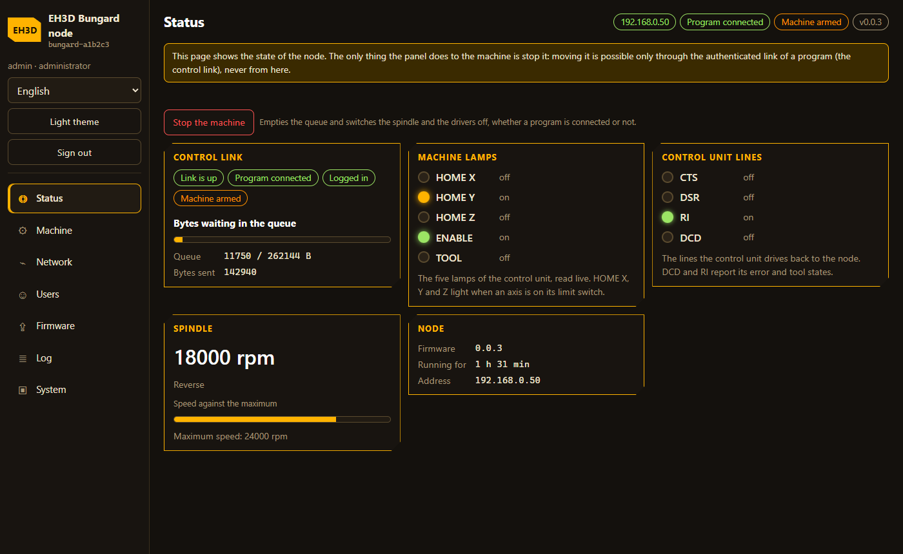
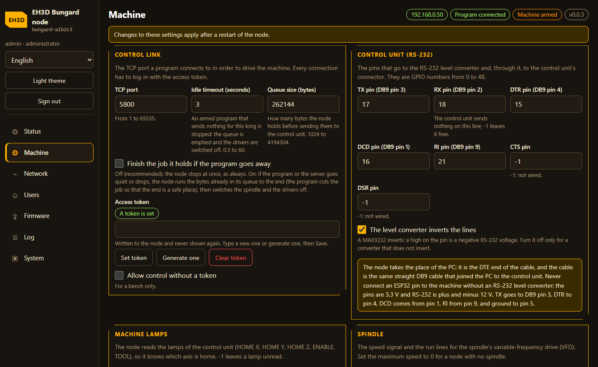
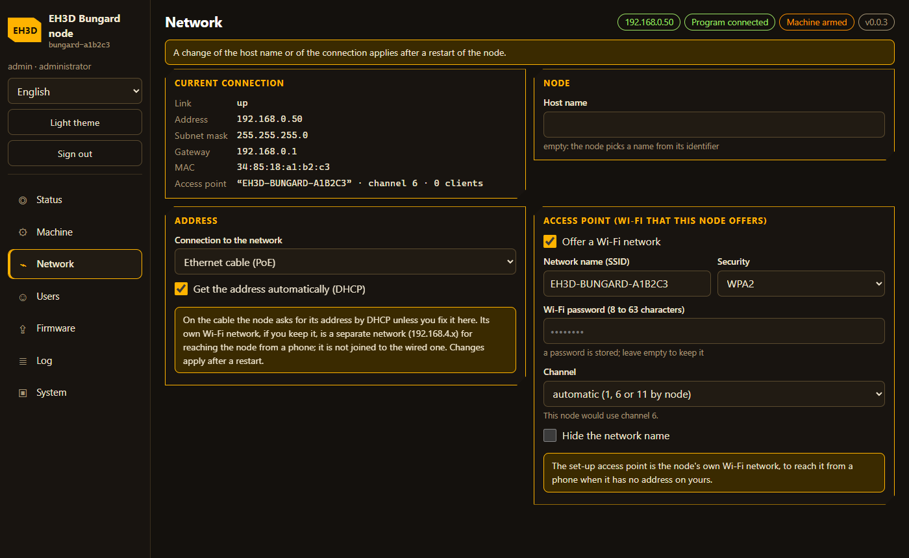
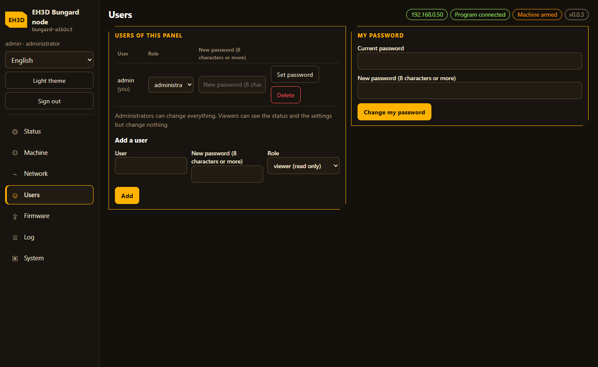
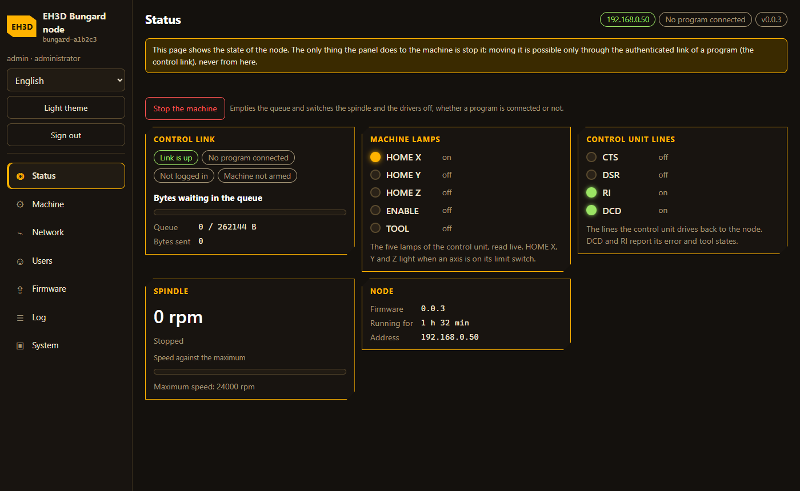
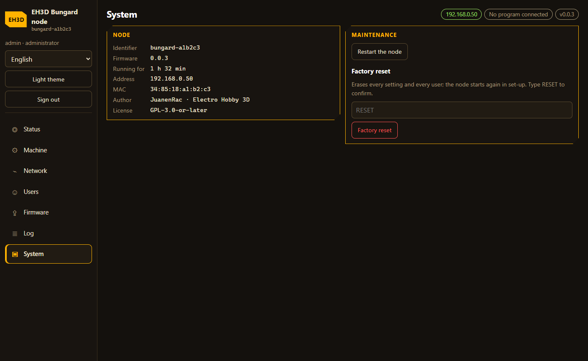

<p align="center">
  
</p>

# 📡 EH3D-NODE-BUNGARD

<p align="center"><a href="README.md">🇺🇸 English</a> | <a href="README_spa.md">🇪🇸 Español</a> | <a href="README_fra.md">🇫🇷 Français</a> | <a href="README_ita.md">🇮🇹 Italiano</a> | <a href="README_deu.md">🇩🇪 Deutsch</a> | <a href="README_zho.md">🇨🇳 中文</a> | <a href="README_jpn.md">🇯🇵 日本語</a> | 🇵🇹 <b>Português</b></p>

### Um nó ESP32-S3 que fica na caixa de uma máquina Bungard CCD, liga-se à porta RS-232 da sua unidade de controlo e deixa os programas EH3D manejar a máquina por Ethernet ou Wi-Fi, com os LED da máquina e o variador do fuso na mesma placa

<p align="center">
  
  
  
  
  
</p>

---

**Verificação de honestidade - o que funciona hoje:** firmware em C++17 para o ESP32-S3 (ESP-IDF 5.5) que transforma a porta RS-232 da unidade de controlo de uma máquina Bungard CCD numa porta de rede: um programa liga-se por TCP com um token de acesso, arma a máquina e envia os bytes de um movimento, que o nó põe em fila e envia para a linha ao ritmo próprio da linha. Também lê os LED da máquina (HOME X, Y e Z, ENABLE, TOOL), comanda um fuso com um sinal de velocidade de 0-10 V e linhas de marcha e sentido, e tem um painel web com menu lateral (oito idiomas) para a configuração inicial, os utilizadores, a rede, a atualização e as definições da própria máquina. As regras da ligação e as definições são testadas num computador (9 programas de teste, 2209 verificações contadas) e o firmware compila sem avisos para as duas placas. **Ainda não foi gravado nem executado numa placa**, nada foi ligado a uma máquina, e a placa de suporte que reúne o conversor RS-232, as entradas dos LED e o variador do fuso é um projeto em papel.

---

> **Estado de segurança (safety) e de segurança informática:** isto não é um sistema de segurança (safety). Um nó mal ligado, ou um variador do fuso mal configurado, pode mover uma máquina ou fazer rodar uma ferramenta. O nó recusa ser controlado sem um token de acesso, só aceita bytes para a máquina enquanto um programa a armou e pára (fila esvaziada, drivers dos motores e fuso desligados) quando a sessão se cala ou a ligação cai (a menos que esteja ativa a definição opcional que o deixa terminar o trabalho que tem). Não vê os fins de curso da máquina a não ser pelos LED e ainda não tem paragem de emergência própria (a placa de suporte tem lugar para uma entrada de botão). O variador do fuso está à tensão da rede: ligue-o e configure-o com o manual do fabricante. O painel nunca move a máquina e recusa guardar definições enquanto um programa tem a máquina armada. O projeto é independente: não é feito, aprovado nem apoiado pela Bungard Elektronik, e os nomes de produtos aparecem só para dizer com que máquinas e variadores se destina a funcionar.

## 📋 Num relance

| | |
|---|---|
| Versão | `0.0.3` |
| Maturidade | Estrutura inicial |
| Testes | 9 programas de teste no computador (2209 verificações contadas) |
| Tecnologias | C++17, ESP-IDF 5.5, ESP32-S3 |
| Em hardware real | Não: as duas imagens de firmware compilam, mas nada foi gravado nem executado numa placa e nada foi ligado a uma máquina |

**Ir para:** [Visão geral](#-visão-geral) · [Arquitetura](#-arquitetura) · [Início rápido](#-início-rápido) · [Testes](#-testes) · [Estrutura](#-estrutura-do-repositório) · [Relacionados](#-projetos-relacionados)

## 🚦 Estado do projeto

Cada linha é uma parte deste repositório e a luz diz até onde chega hoje. É escrita com o que o repositório consegue demonstrar (testes, compilações, execuções), não com o que está previsto.

🟢 Feito e verificado · 🟡 Funciona, com limites conhecidos · 🟠 Feito a meio ou ainda por verificar · 🔴 Por fazer ou a não funcionar

| Área | Estado | O que significa aqui |
|---|---|---|
| Software | 🟡 | O firmware para o ESP32-S3 (ESP-IDF 5.5, C++17) compila sem avisos para as duas placas, Ethernet e Wi-Fi; nenhuma imagem foi gravada. |
| Testes | 🟡 | Passam 9 programas de teste no computador (`ctest`): 2209 verificações contadas na ligação, nas definições, nas regras da máquina e na base partilhada, mais a verificação dos textos do painel (315 linhas em 8 idiomas) e das pilhas das tarefas (10 tarefas). |
| Ligação de controlo | 🟡 | O protocolo com tramas (CRC, início de sessão com token, armamento, fila de bytes, paragem quando a sessão se cala) está coberto pelos testes no computador; nenhum programa falou com um nó real. |
| Painel web | 🟡 | O painel web (menu lateral, oito idiomas: configuração inicial, máquina, rede, utilizadores, atualização, registo, sistema) tem os textos verificados e é exercitado contra uma simulação do nó num navegador; nunca foi servido a partir de uma placa. |
| Fuso e LED | 🟠 | O sinal de velocidade de 0-10 V, as linhas de marcha e sentido (sem inverter enquanto roda) e as cinco entradas de LED são testados no computador; nenhum variador nem máquina foi ligado. |
| Atualizações | 🟠 | O carregamento para um dos dois espaços de firmware com reversão e confirmação é testado no computador; uma atualização nunca correu numa placa. |
| Segurança | 🟡 | Código de configuração na consola USB, token de acesso, utilizadores e papéis, HTTPS opcional e nada de secreto compilado; pára sozinho quando a ligação cai. Ainda não tem entrada de paragem de emergência nem revisão independente. |
| Hardware real | 🔴 | Nenhuma placa executou este firmware, e a placa de suporte com o conversor RS-232, as entradas dos LED e o variador do fuso é apenas um projeto em papel. |
| Documentação | 🟡 | README em oito idiomas, o protocolo, o firmware, a cablagem e o projeto da placa de suporte. |

## 🎯 Visão geral

* A **ligação de controlo** (TCP, porta 5800 por omissão): um protocolo com tramas e CRC, um início de sessão com token de acesso, o armamento, uma fila de bytes para a unidade de controlo e uma paragem quando a sessão se cala ou cai. O programa envia os bytes de um movimento já espaçados e a UART do nó coloca-os na linha com exatidão, o que um adaptador USB-série não consegue fazer a alta velocidade.
* A **linha série para a unidade de controlo**: 38400 baud 8N1 através de um MAX3232, com as linhas DTR, DCD e RI do handshake. Os pinos e o facto de o transcetor inverter ou não as linhas são definições.
* Os **LED**: HOME X, HOME Y, HOME Z, ENABLE e TOOL são lidos através de um transístor separador, mostrados no estado e no painel, e um pedido pode fazer o nó abandonar o resto de uma procura assim que um eixo chega a casa, de modo que o programa já não tem de ler a linha de casa a meio do fluxo.
* O **fuso**: um PWM de velocidade para um conversor de 0-10 V (24000 rpm a sinal máximo por omissão, para um variador de frequência como o Huanyang HY02D223B) e linhas de marcha para a frente / para trás, sem mudança de sentido enquanto roda nem logo depois de parar, e uma paragem sempre que a máquina pára.
* O **painel** (HTTP e HTTPS, oito idiomas, o menu à esquerda num ecrã largo e em cima num telemóvel): configuração inicial com um código mostrado na consola USB, utilizadores, Ethernet ou Wi-Fi, a ligação de controlo, os pinos RS-232, os LED e o fuso, um registo e atualizações por carregamento para um dos dois espaços de firmware com reversão. Nada de secreto é compilado na imagem.
* A **autoproteção**: um guarda que vigia as tarefas e a memória, um portão à porta do painel quando falta memória e a confirmação de uma imagem nova assim que o nó é alcançável.
* As **placas**: a Waveshare ESP32-S3-ETH (Ethernet W5500) e uma ESP32-S3-WROOM-1 N16R8 (Wi-Fi), uma imagem para cada uma. O projeto da placa de suporte (100 x 100 mm) está em `docs/BOARD.md`.
* As **máquinas**: a Bungard CCD MTC e a CCD/2 MTC, com a unidade de controlo de porta série do software DOS 4.6. Os dois modelos ATC não estão cobertos; os modelos XL e as máquinas posteriores têm uma unidade de controlo moderna própria.
* O **fim autónomo** (desativado por omissão, uma definição): quando o programa ou o servidor desaparece, o nó executa até ao fim os bytes que já tem na fila - incluindo os comandos de fuso em fila - e depois desliga o fuso e os drivers. A fila vive na RAM externa (até 4 MB, minutos de movimento), um limite de tempo termina-a e também um Abort e o botão de paragem do painel. **Previsto, ainda por construir**: uma entrada de botão para uma paragem física.

## 🧩 Papel no EH3D

O EH3D-NODE-BUNGARD é a última etapa entre os programas EH3D e a máquina: o EH3D-DRILLPRO e o EH3D-ROUTEPRO ligam-se a ele hoje, e o EH3D-SERVER fica à frente para os outros clientes. É o primeiro nó da família EH3D e as suas definições, o seu painel e o mecanismo de atualização destinam-se a ser partilhados com os nós seguintes (a base comum vive no EH3D-COMMON).

## 🏛️ Arquitetura

<p align="center">
  
</p>

Como as partes deste repositório se encaixam: quem o usa, o que contém e de que depende. A imagem é desenhada a partir de `docs/architecture.json` e verificada com o código.

## 🖼️ Capturas de ecrã

<p align="center">
  
</p>

<p align="center"><em>A página Estado, no tema Forge dos outros programas EH3D: a ligação de controlo, os indicadores da máquina, as linhas da unidade de controlo e o fuso. É servida pelo nó de teste com que se desenvolve o painel: nenhuma placa executou ainda o firmware.</em></p>

<p align="center">
  
</p>

<p align="center"><em>A página Máquina: a ligação de controlo, os pinos RS-232, os indicadores e o token de acesso.</em></p>

<p align="center">
  
</p>

<p align="center"><em>A página Rede: como o nó chega à rede.</em></p>

<p align="center">
  
</p>

<p align="center"><em>A página Utilizadores: as pessoas que podem abrir o painel e o seu perfil.</em></p>

<p align="center">
  
</p>

<p align="center"><em>A página Firmware: as duas ranhuras, a que está em execução e a atualização com regresso.</em></p>

<p align="center">
  
</p>

<p align="center"><em>A página Sistema: a identidade do nó, o reinício e o restabelecimento de fábrica.</em></p>

## ✨ Funcionalidades

* **Um painel com menu lateral:** sete páginas (Estado, Máquina, Rede, Utilizadores, Firmware, Registo, Sistema), o menu à esquerda num ecrã largo e em cima num telemóvel, com o idioma, o tema e o fim de sessão ao lado.
* **Uma imagem, sem segredos:** tudo o que muda de nó para nó é um documento de definições na flash editado a partir do painel; nenhuma palavra-passe, token ou rede é compilada.
* **Bytes com a temporização certa:** o programa coloca cada passo e a UART do nó envia os bytes ao ritmo próprio da linha, o que um adaptador USB não consegue manter.
* **Casa vista em direto:** os cinco LED são lidos e um pedido abandona o resto de uma procura assim que um eixo chega a casa.
* **Fuso com proteções:** velocidade limitada à máxima para que o nó foi construído, sem inverter enquanto roda nem logo depois de parar, paragem com a máquina.
* **Atualização com reversão:** uma imagem entra no espaço que não está em uso e fica em prova até o nó ser alcançável; o carregador de arranque volta atrás quando não é.
* **Cuida de si:** um guarda vigia as tarefas e a memória, e um nó sem endereço após noventa segundos reabre a rede de configuração para não ficar inalcançável.

## 🔒 Segurança e proteção

| Ameaça | Defesa |
|---|---|
| Alguém na rede a comandar a máquina | a ligação recusa tudo exceto Hello até o token de acesso (8 a 64 carateres imprimíveis) estar certo; um nó sem token recusa o controlo a menos que a definição de bancada `allow_open` esteja ativa (desativada por omissão); um programa de cada vez |
| Um programa que move a máquina por acidente | os bytes só são aceites com o nó armado e só se a trama inteira couber na fila; um comando de fuso é cortado à velocidade máxima e recusado se invertesse um fuso que roda |
| Um cabo que se solta ou um programa que morre a meio de um movimento | uma sessão armada que se cala durante `idle_ms` (3000 ms por omissão) ou cuja ligação cai esvazia a fila e envia o byte de drivers desligados `0xC0`; o fuso vai a 0 rpm |
| Alguém que chega ao painel | o primeiro administrador cria-se com um código de configuração que só aparece na consola USB; dois papéis (administrador, observador); uma palavra-passe errada é abrandada e um endereço de origem que continua a falhar é bloqueado durante algum tempo; HTTP, HTTPS ou ambos |
| Segredos no firmware ou no repositório | nada de secreto é compilado: o token, a rede e os pinos são definições na flash; o token é só de escrita no painel e na API |
| Uma escrita de definições que pára um movimento | enquanto um programa tem a máquina armada o painel recusa guardar definições (HTTP 409 `machine_armed`) e adia um reinício |
| Uma atribuição de pinos errada | os pinos que a placa reserva (flash, PSRAM, USB, o chip Ethernet) são recusados e nenhum pino pode fazer dois trabalhos |
| Uma imagem de firmware má | uma imagem de outro projeto ou um espaço vazio é recusado; uma imagem nova fica em prova e o carregador de arranque volta à anterior se o painel não arrancar ou o nó não for alcançável em cinco minutos |
| Um nó que fica sem memória ou bloqueia | um guarda vigia as tarefas e a memória interna e reinicia sem formar um ciclo; um portão à porta do painel quando falta memória |
| Alguém com o nó nas mãos | manter BOOT oito segundos nos primeiros trinta depois de ligar apaga as definições e os utilizadores (o acesso físico é um reinício por desenho) |

**O que não é defendido:** o nó ainda não tem entrada de paragem de emergência e só vê os fins de curso pelos LED; a atualização não está assinada (a atualização a partir do GitHub não está construída: precisa de uma chave de assinatura); o certificado próprio do painel HTTPS faz o navegador avisar; nada correu numa placa e não houve revisão independente. Comunique uma vulnerabilidade em privado (ver [SECURITY.md](SECURITY.md)).

## 🔌 Interfaces

| Interface | O que é | Onde |
|---|---|---|
| Ligação de controlo | TCP, porta 5800 por omissão: tramas `0xB5, tipo, comprimento, carga, CRC-16`, Hello com o token, Arm, Write, Abort, Ping, StopOnHome, Spindle; o nó responde Info, Status (a cada 200 ms), Rx, HomeSeen e Error | [docs/PROTOCOL.md](docs/PROTOCOL.md), `core/frame.hpp`, `main/link_server.cpp` |
| Painel web | HTTP na porta 80 e HTTPS na 443 (o modo é uma definição), oito idiomas, API em `/api/v1/` (`GET`/`PUT /api/v1/machine`, `GET /api/v1/machine/status` e as rotas partilhadas da base) | [docs/NODE_FIRMWARE.md](docs/NODE_FIRMWARE.md), `main/web_server.cpp`, `panel/` |
| RS-232 para a unidade de controlo | UART a 38400 baud 8N1 através de um MAX3232, com DTR (saída), DCD e RI (entradas) | [docs/WIRING.md](docs/WIRING.md), `main/central_uart.cpp` |
| LED | HOME X, HOME Y, HOME Z, ENABLE e TOOL, cinco entradas através de um transístor separador | [docs/WIRING.md](docs/WIRING.md), `main/lamps.cpp` |
| Fuso | um PWM de velocidade para um conversor de 0-10 V e linhas de marcha para a frente / para trás | [docs/BOARD.md](docs/BOARD.md), `main/spindle.cpp` |
| Consola USB | mostra o código de configuração e aceita Improv Wi-Fi por série | `main/improv_serial.cpp` |
| Rede de configuração | o nó abre o Wi-Fi `EH3D-SETUP-xxxxxx` enquanto não tem utilizadores | [docs/NODE_FIRMWARE.md](docs/NODE_FIRMWARE.md) |

## ⚙️ Configuração

Tudo é uma definição na flash, editada a partir do painel (página Máquina), por isso uma só imagem serve para cada nó. Os valores abaixo são os de um nó nunca configurado; um valor fora de gama é recusado ao guardar.

| Definição | Por omissão | Gama | O que faz |
|---|---|---|---|
| `machine.link.port` | 5800 | de 1024 a 65535 | a porta TCP da ligação de controlo |
| `machine.link.token` | nenhum | de 8 a 64 carateres imprimíveis; só de escrita | o token de acesso; sem um o nó recusa ser controlado |
| `machine.link.allow_open` | desativado | ativado ou desativado | uma definição de bancada: aceitar controlo sem token |
| `machine.link.idle_ms` | 3000 | de 200 a 60000 | quanto tempo uma sessão armada pode estar calada antes de o nó parar |
| `machine.link.queue_bytes` | 262144 | de 1024 a 4194304 | a fila de bytes para a unidade de controlo, na RAM externa |
| `machine.link.finish_on_loss` | desativado | ativado ou desativado | terminar o trabalho que já está na fila quando o programa desaparece |
| `machine.link.max_drain_s` | 600 | de 10 a 3600 | os segundos máximos que o nó pode continuar sozinho nesse caso |
| `machine.uart.*` | tx 17, rx 18, dtr 15, dcd 16, ri 21, cts e dsr sem ligar; o transcetor inverte | um pino livre da placa, ou -1 onde é opcional | os pinos da linha série |
| `machine.lamps.*` | HOME X 1, Y 2, Z 7, ENABLE 8, TOOL 38; ativos a nível baixo | um pino livre | as cinco entradas de LED |
| `machine.spindle.max_rpm` | 24000 | de 0 a 65535 (0: sem saída de fuso) | a velocidade a sinal máximo |
| `machine.spindle.pwm_hz` | 2000 | de 100 a 40000 | a frequência do sinal de velocidade |
| `machine.spindle.reverse_delay_ms` | 3000 | de 0 a 60000 | quanto tempo o fuso tem de ter estado parado antes de poder rodar ao contrário |
| `web.mode` | `both` | `http`, `both` ou `https` | se o painel é servido na porta 80, na 443 ou em ambas |

Os pinos do fuso (PWM 4, frente 5, trás 6) também são definições. As definições que todo o nó tem (nome, acesso, ponto de acesso, endereço, relógio, idioma, reinício periódico) estão na base e descritas em [docs/NODE_FIRMWARE.md](docs/NODE_FIRMWARE.md).

## 🚀 Início rápido

Precisa de um compilador C++17 e do CMake para os testes no computador, e do ESP-IDF 5.5 (ou Docker) para o firmware.

```bash
build.bat            # the host tests (Windows)  -  ./build.sh on Linux
tools/build_node.sh s3-eth      # or s3-wifi: the firmware, in the ESP-IDF container
python -I tools/ci_validate.py
```

`tools/build_node.sh s3-eth` (ou `s3-wifi`) compila uma imagem no contentor ESP-IDF; no Windows um ESP-IDF 5.5.5 instalado faz o mesmo. A imagem `dist/eh3d-node-bungard-<versão>-<placa>-complete.bin` é para UMA placa: grave-a no endereço 0 com `python -m esptool --chip esp32s3 -p COMx write_flash 0x0 <imagem>`. Depois junte-se ao Wi-Fi `EH3D-SETUP-xxxxxx` que o nó abre, abra `http://192.168.4.1/` e introduza o código de configuração que o nó mostra na sua consola USB; o token de acesso, a rede e os pinos definem-se a partir do painel. Este caminho ainda não foi seguido numa placa real.

## 🧪 Testes

Os testes no computador (`build.bat` ou `./build.sh`, depois `ctest`) são 9 programas e todos passam: `core_tests` (104 verificações: as tramas e as regras de sessão), `test_base` (382), `test_clock` (imprime ok), `test_settings` (392), `test_machine` (75), `test_shared` (627) e `test_shared_eth` (629, o perfil da placa Ethernet) - 2209 verificações contadas - mais `panel_text` (315 linhas em 8 idiomas, 265 chaves usadas, 36 códigos de erro do firmware com texto) e `task_safety` (10 tarefas, nenhuma cópia grande das definições numa pilha pequena). Cobrem o CRC e o descodificador que se ressincroniza após dano, o início de sessão com token, o armamento, a paragem por silêncio, as regras do fuso (limite, sem inversão, atraso), as definições e as suas gamas, conflitos de pinos e pinos reservados, utilizadores e sessões, o plano de rede, o relógio e JSON. O painel também foi exercitado num navegador contra `tools/panel_mock.mjs`, um nó de substituição que o serve sem placa. A CI executa `python -I tools/ci_validate.py` e os testes no computador em Linux com os avisos como erros. A compilação das duas imagens de firmware (ESP-IDF 5.5.5) faz-se à mão e não faz parte da CI; nada corre numa placa.

## 🏗️ Compilação e publicação

A versão vive em `eh3d.project.json` e na compilação, e cada versão tem a sua entrada em [CHANGELOG.md](CHANGELOG.md). `build.sh` / `build.bat` compilam e executam os testes no computador e `test.sh` / `test.bat` executam só os testes, cada um num painel em direto; nenhum altera a versão. As imagens de firmware saem de `tools/build_node.sh` (ou do ESP-IDF 5.5.5 no Windows) e chamam-se `eh3d-node-bungard-<versão>-<placa>-{app,complete}.bin`. Ainda não foi publicada nenhuma versão nem gravada nenhuma imagem. A atualização a partir do GitHub não está construída: precisa de uma chave de assinatura.

## 🩺 Resolução de problemas

| Sintoma | O que fazer |
|---|---|
| Não se consegue chegar ao nó | Um nó sem endereço após noventa segundos reabre a rede de configuração `EH3D-SETUP-xxxxxx`; junte-se a ela e defina o acesso a partir do painel. |
| O código de configuração perdeu-se | Só aparece na consola USB, a cada quinze segundos. Manter BOOT oito segundos nos primeiros trinta depois de ligar apaga as definições e os utilizadores e recomeça a configuração. |
| A ligação responde Error 1 ou 2 | Sem sessão iniciada, ou token errado: a primeira trama tem de ser Hello com o token de acesso definido no painel (página Máquina). |
| Error 3 ou 4 | Não está armado (envie primeiro Arm) ou a fila está cheia (espere que o Status mostre espaço). |
| Error 7 | A sessão armada calou-se durante `idle_ms`: envie Ping enquanto houver um movimento longo em fila. |
| Error 9, 10 ou 11 | O fuso tem de parar antes de inverter, esteve parado pouco tempo para inverter, ou o nó está a terminar o trabalho que tem. |
| O painel recusa guardar (409 `machine_armed`) | Um programa tem a máquina armada; desarme-a ou prima o botão de paragem da página Estado, e guarde de novo. |
| O navegador avisa sobre o painel HTTPS | O nó cria o seu próprio certificado da primeira vez; use o modo `http` ou `both` numa rede de confiança, ou aceite o certificado. |

## 📂 Estrutura do repositório

<p align="center">
  
</p>

<details>
<summary>Versão em texto da árvore</summary>

```text
EH3D-NODE-BUNGARD/
├── core/
│   ├── frame.hpp session.hpp                    tramas e regras de sessão
│   ├── byte_queue.hpp drain.hpp                 fila de bytes, fim do trabalho
│   ├── bungard_config.hpp                       definições da máquina e pinos
│   ├── node_settings.hpp auth.hpp               definições, utilizadores (base)
│   └── netplan.hpp json.hpp                     plano de rede e JSON (base)
├── main/
│   ├── app_main.cpp link_server.cpp             arranque e ligação de controlo
│   ├── central_uart.cpp lamps.cpp               linha série e LED
│   ├── spindle.cpp machine_api.cpp              saídas do fuso, API
│   ├── web_server.cpp network.cpp               servidor do painel, rede (base)
│   └── node_store.cpp node_guard.cpp            armazenamento, guarda (base)
├── panel/
│   ├── index.html style.css                     a página e a disposição do menu lateral
│   └── app.js text.js                           as páginas e os textos em oito idiomas
├── tests/                                       testes no computador da ligação, das definições, da base partilhada e dos textos do painel
├── docs/                                        protocolo, firmware, cablagem, placa
├── tools/                                       compilação, painel, verificações, nó simulado
├── CMakeLists.txt                               o projeto ESP-IDF
├── partitions.csv                               a flash com dois espaços
├── sdkconfig.*                                  definições ESP-IDF e perfis
├── images/                                      banner e as imagens de Arquitetura e Estrutura do repositório
├── .github/                                     fluxos de CI e de publicação, modelos de issues e pull requests
├── build.sh build.bat                           compila e executa os testes no computador num painel em direto
├── eh3d.project.json                            manifesto: versão, papel, maturidade e comando de compilação
├── CHANGELOG.md                                 o que mudou em cada versão
├── SECURITY.md SUPPORT.md                       como comunicar uma vulnerabilidade e onde perguntar
└── CONTRIBUTING.md CODE_OF_CONDUCT.md LICENSE   como contribuir, o código de conduta e a licença
```

</details>

## 🗺️ Roteiro e limites conhecidos

**Limites conhecidos hoje**

* Nada correu numa placa: nenhuma imagem foi gravada, nenhuma configuração foi feita num nó real, nenhum programa falou com um e nada foi ligado a uma máquina.
* A placa de suporte com o conversor RS-232, as entradas dos LED e o variador do fuso é um projeto em papel (`docs/BOARD.md`).
* O nó não tem entrada de paragem de emergência (a placa de suporte tem lugar para um botão) e só vê os fins de curso pelos LED.
* A atualização a partir do GitHub não está construída: precisa de uma chave de assinatura. O painel foi visto num navegador contra um nó de substituição, não servido a partir de uma placa.
* O fim do trabalho retido não correu numa placa; as suas regras são testadas num computador.
* Só se pretendem as máquinas Bungard CCD MTC e CCD/2 MTC; os modelos ATC não estão cobertos.

**A seguir**

* Gravar uma imagem em cada placa, fazer a primeira configuração e verificar a ligação com a biblioteca Rust.
* Desenhar e construir a placa de suporte e ligar um variador de fuso e uma máquina.
* Acrescentar a entrada de botão para uma paragem física.
* Assinar as atualizações e descarregá-las do GitHub.

## 🌍 Idiomas

O README e os textos existem em inglês, espanhol, francês, italiano, alemão, chinês, japonês e português europeu.

## 🔗 Projetos relacionados

* [EH3D-DRILLPRO](https://github.com/JuanenRac/EH3D-DRILLPRO): o programa de furação; maneja a máquina através deste nó com `connection = node`
* [EH3D-ROUTEPRO](https://github.com/JuanenRac/EH3D-ROUTEPRO): o programa de fresagem; partilha a biblioteca do protocolo e o ficheiro de máquina
* [EH3D-COMMON](https://github.com/JuanenRac/EH3D-COMMON): as partes comuns da família EH3D; a base do firmware do nó vive lá
* [EH3D-SERVER](https://github.com/JuanenRac/EH3D-SERVER): o centro da família EH3D: executa os trabalhos dos programas e dos outros clientes na máquina através deste nó

## 📚 Documentação

* [A ligação de controlo](docs/PROTOCOL.md): tramas, início de sessão, armamento, fila, fuso, LED e as regras que param a máquina.
* [O firmware](docs/NODE_FIRMWARE.md): configuração inicial, definições, painel, atualização com reversão, memória e autoproteção.
* [Cablagem](docs/WIRING.md): a porta RS-232, os LED e o variador do fuso.
* [A placa de suporte](docs/BOARD.md): o projeto a partir do qual desenhar o esquema.
* [Registo de alterações](CHANGELOG.md)

## 🤝 Contribuir e comunidade

* Antes de um pull request execute os testes no computador (`./build.sh` ou `build.bat`) e `python -I tools/ci_validate.py`: tudo tem de passar. Consulte [CONTRIBUTING.md](CONTRIBUTING.md) e o [código de conduta](CODE_OF_CONDUCT.md).
* O README existe em oito idiomas: uma alteração ao texto faz-se nos oito ficheiros, e as duas imagens são desenhadas a partir de `docs/architecture.json` e `docs/structure.json` com `tools/make_architecture.py` e `tools/make_structure.py`.
* Nada que envie bytes a uma unidade de controlo real muda sem uma nota do que foi observado no hardware (ou com um analisador lógico) e um teste com o simulador ou o nó de substituição.
* Comunique uma vulnerabilidade em privado: [SECURITY.md](SECURITY.md). Perguntas, ideias e relatórios: electrohobby3d@gmail.com ([SUPPORT.md](SUPPORT.md)).

## 👤 AUTOR

**JuanenRac (Electro Hobby 3D)** · electrohobby3d@gmail.com

## 📜 LICENÇA

Software: GPL-3.0-or-later. Ver [LICENSE](LICENSE). Os projetos de hardware da suite usam a CERN OHL-S.
