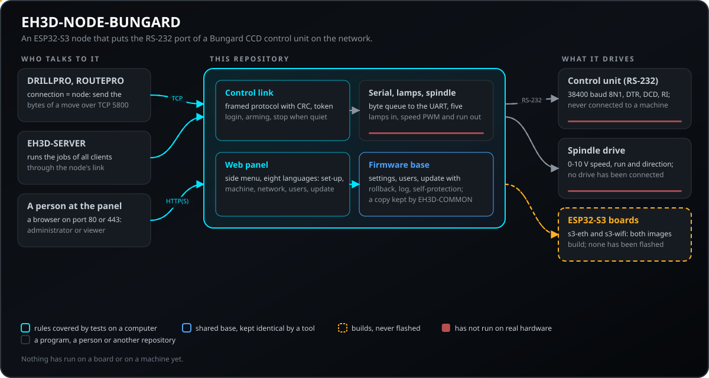
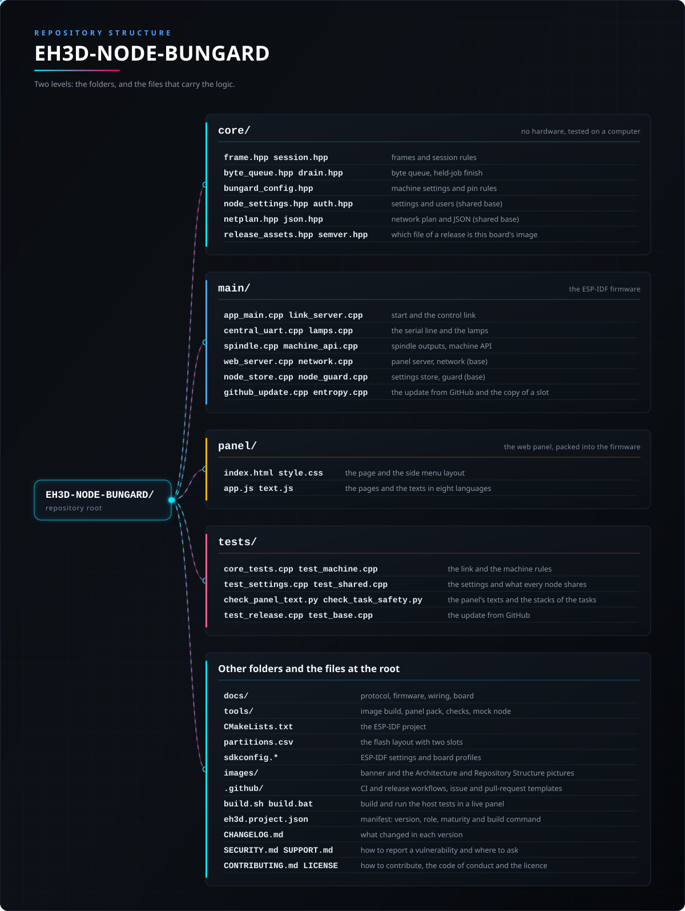

<p align="center">
  
</p>

# 📡 EH3D-NODE-BUNGARD

<p align="center"><a href="README.md">🇺🇸 English</a> | <a href="README_spa.md">🇪🇸 Español</a> | <a href="README_fra.md">🇫🇷 Français</a> | <a href="README_ita.md">🇮🇹 Italiano</a> | <a href="README_deu.md">🇩🇪 Deutsch</a> | 🇨🇳 <b>中文</b> | <a href="README_jpn.md">🇯🇵 日本語</a> | <a href="README_por.md">🇵🇹 Português</a></p>

### 一个 ESP32-S3 节点，安装在 Bungard CCD 机床的机箱里，接到其控制单元的 RS-232 端口，让 EH3D 程序通过以太网或 Wi-Fi 驱动机床，机床的指示灯和主轴驱动器在同一块板上

<p align="center">
  
  
  
  
  
</p>

---

**诚实性核对 - 今天真正能运行的内容：** ESP32-S3（ESP-IDF 5.5）的 C++17 固件，把 Bungard CCD 机床控制单元的 RS-232 端口变成网络端口：程序用访问令牌通过 TCP 连接、给机床上膛并发送运动的字节，节点把它们排队，并以线路自身的节奏送到线上。它还读取机床的指示灯（HOME X、Y、Z，ENABLE，TOOL），通过 0-10 V 速度信号和运行/方向线驱动主轴，并带有侧边菜单的网页面板（八种语言），用于设置、用户、网络、更新和机床自身的设置。链路规则和设置已在计算机上测试（9 个测试程序，统计到 2,209 项检查），固件在两种板子上都无警告地编译。**尚未烧录或在电路板上运行**，也没有接到任何机床上，而把 RS-232 转换器、指示灯输入和主轴驱动器集合起来的载板只是纸面上的设计。

---

> **安全（safety）与信息安全现状：** 这不是安全系统（safety）。接线错误的节点或设置错误的主轴驱动器，都可能使机床运动或使刀具旋转。节点没有访问令牌就拒绝被控制，只在程序已让它上膛期间接收给机床的字节，并在会话沉默或连接断开时停止（清空队列，关闭步进驱动器和主轴；除非开启了让它完成所持作业的可选设置）。它只能通过指示灯看到机床的限位开关，也还没有自己的急停（载板上留有按钮输入的位置）。主轴驱动器接市电：请按厂家手册接线和设置。面板绝不会移动机床，并且在程序让机床处于上膛状态时拒绝保存设置。该项目是独立的：不由 Bungard Elektronik 制造、认可或支持，出现产品名称只是为了说明它打算配合哪些机床和驱动器使用。

## 📋 速览

| | |
|---|---|
| 版本 | `0.0.2` |
| 成熟度 | 脚手架 |
| 测试 | 9 个主机测试程序（统计到 2,209 项检查） |
| 技术栈 | C++17, ESP-IDF 5.5, ESP32-S3 |
| 真实硬件 | 否：两个固件镜像都能编译，但没有烧录或在电路板上运行过，也没有接到机床上 |

**跳转到：** [概述](#-概述) · [架构](#-架构) · [快速开始](#-快速开始) · [测试](#-测试) · [结构](#-仓库结构) · [相关项目](#-相关项目)

## 🚦 项目状态

每一行是本仓库的一个部分，灯号表示它今天做到了哪一步。内容依据仓库能够展示的证据（测试、构建、运行），而不是计划。

🟢 已完成并验证 · 🟡 可用，有已知限制 · 🟠 部分完成或尚未验证 · 🔴 未完成或不可用

| 领域 | 状态 | 在这里的含义 |
|---|---|---|
| 软件 | 🟡 | ESP32-S3（ESP-IDF 5.5，C++17）的固件在以太网和 Wi-Fi 两种板子上都无警告地编译；还没有烧录任何镜像。 |
| 测试 | 🟢 | 9 个主机测试程序通过（`ctest`）：针对链路、设置、机床规则和共享基础的 2,209 项检查，另有面板文本（8 种语言共 315 行）和任务栈（10 个任务）的检查。 |
| 控制链路 | 🟡 | 帧协议（CRC、令牌登录、上膛、字节队列、会话沉默时停止）由主机测试覆盖；还没有程序与真实节点通信过。 |
| 网页面板 | 🟡 | 网页面板（侧边菜单，八种语言：设置、机床、网络、用户、更新、日志、系统）的文本已检查，并在浏览器中对节点的模拟进行过测试；从未从电路板上提供过服务。 |
| 主轴与指示灯 | 🟠 | 0-10 V 速度信号、运行和方向线（旋转时不允许反转）以及五路指示灯输入已在主机上测试；没有连接过主轴驱动器或机床。 |
| 更新 | 🟠 | 上传到两个固件槽之一并带回滚和确认的流程已在主机上测试；更新从未在电路板上运行。 |
| 安全 | 🟡 | USB 控制台上的设置码、访问令牌、用户和角色、可选的 HTTPS，且没有把机密编译进去；链路断开时会自行停止。尚无急停输入，也未经独立审查。 |
| 真实硬件 | 🔴 | 没有电路板运行过这个固件，带有 RS-232 转换器、指示灯输入和主轴驱动器的载板只是纸面上的设计。 |
| 文档 | 🟢 | 八种语言的 README、协议、固件、接线和载板设计。 |

## 🎯 概述

* **控制链路**（TCP，默认端口 5800）：带 CRC 的帧协议、使用访问令牌登录、上膛、给控制单元的字节队列，以及会话沉默或断开时停止。程序发送已按间隔排好的运动字节，节点的 UART 把它们准确地放到线上，这是 USB 串口适配器在高速下做不到的。
* **通往控制单元的串行线路**：通过 MAX3232 的 38400 波特 8N1，带握手用的 DTR、DCD 和 RI 线。引脚以及收发器是否反相线路都是设置项。
* **指示灯**：HOME X、HOME Y、HOME Z、ENABLE 和 TOOL 通过缓冲晶体管读取，显示在状态和面板中，一个请求可以让节点在某个轴回到原点的瞬间丢弃搜索的剩余部分，因此程序不必再在数据流中间读取原点线。
* **主轴**：用于 0-10 V 转换器的速度 PWM（默认满信号对应 24000 rpm，面向 Huanyang HY02D223B 之类的变频器）和正转/反转线，旋转时或刚停止后不会换向，机床一停止它就停止。
* **面板**（HTTP 和 HTTPS，八种语言，宽屏时菜单在左侧，手机上在顶部）：用 USB 控制台显示的代码进行首次设置、用户、以太网或 Wi-Fi、控制链路、RS-232 引脚、指示灯和主轴、日志，以及上传到两个固件槽之一并可回滚的更新。镜像中没有编译进任何机密。
* **自我保护**：监视任务和内存的看门狗，内存不足时面板入口处的闸门，以及节点可被访问后对新镜像的确认。
* **板子**：Waveshare ESP32-S3-ETH（W5500 以太网）和 ESP32-S3-WROOM-1 N16R8（Wi-Fi），各有一个镜像。载板（100 x 100 mm）的设计在 `docs/BOARD.md` 中。
* **机床**：带 DOS 软件 4.6 串口控制单元的 Bungard CCD MTC 和 CCD/2 MTC。两个 ATC 型号不在范围内；XL 型号及之后的机床有自己的现代控制单元。
* **自主完成**（默认关闭，一个设置）：程序或服务器消失时，节点把队列中已有的字节（包括排队的主轴命令）执行到结束，然后关闭主轴和驱动器。队列存放在外部 RAM 中（最多 4 MB，可达数分钟的运动），时间限制、Abort 和面板的停止按钮都会终止它。**计划中、尚未构建**：用于物理停止的按钮输入。

## 🧩 在 EH3D 中的角色

EH3D-NODE-BUNGARD 是 EH3D 程序与机床之间的最后一级：目前 EH3D-DRILLPRO 和 EH3D-ROUTEPRO 直接连接它，EH3D-SERVER 则在前面为其他客户端服务。它是 EH3D 家族的第一个节点，其设置、面板和更新机制将与后续节点共享（公共基础位于 EH3D-COMMON）。

## 🏛️ 架构

<p align="center">
  
</p>

本仓库各部分如何协作：谁在使用它、它包含什么、它依赖什么。图片由 `docs/architecture.json` 绘制，并与代码核对。

## ✨ 功能

* **带侧边菜单的面板：** 七个页面（状态、机床、网络、用户、固件、日志、系统），宽屏时菜单在左侧，手机上在顶部，语言、主题和退出登录在旁边。
* **一个镜像，没有机密：** 节点之间不同的一切都是在面板中编辑的、存于闪存的一份设置文档；没有密码、令牌或网络被编译进去。
* **时序正确的字节：** 程序安排每一步，节点的 UART 以线路自身的节奏发送字节，这是 USB 适配器保持不了的。
* **实时看到回原点：** 读取五路指示灯，一个请求可在某个轴回到原点的瞬间丢弃搜索的剩余部分。
* **带护栏的主轴：** 转速限制在节点设计的最高转速以内，旋转时或刚停止后不允许反转，随机床一起停止。
* **可回滚的更新：** 镜像写入未运行的槽，在节点可被访问前处于试用状态；无法访问时引导程序会回退。
* **自我照看：** 看门狗监视任务和内存，九十秒后仍没有地址的节点会重新打开设置网络，避免一直无法访问。

## 🔒 安全与防护

| 威胁 | 防御 |
|---|---|
| 网络上有人驱动机床 | 在访问令牌（8 到 64 个可打印字符）正确之前，链路拒绝除 Hello 外的一切；没有令牌的节点拒绝控制，除非开启了调试用设置 `allow_open`（默认关闭）；一次只允许一个程序 |
| 意外移动机床的程序 | 只在上膛时接收字节，且仅当整帧能放进队列；主轴命令会被限制在最高转速以内，若会使正在旋转的主轴反转则被拒绝 |
| 脱落的电缆，或在运动中途死掉的程序 | 上膛的会话沉默超过 `idle_ms`（默认 3000 ms）或连接断开时，会清空队列并发送驱动器关闭字节 `0xC0`；主轴降到 0 rpm |
| 有人访问面板 | 第一个管理员用只出现在 USB 控制台上的设置码创建；两种角色（管理员、查看者）；错误密码会被减速，持续失败的来源地址会被封锁一段时间；HTTP、HTTPS 或两者 |
| 固件或仓库中的机密 | 没有机密被编译进去：令牌、网络和引脚都是闪存中的设置；令牌在面板和 API 中只可写 |
| 会打断运动的设置写入 | 当程序让机床处于上膛状态时，面板拒绝保存设置（HTTP 409 `machine_armed`），并推迟重启 |
| 错误的引脚分配 | 板子保留的引脚（闪存、PSRAM、USB、以太网芯片）会被拒绝，且任何引脚不得承担两个用途 |
| 有问题的固件镜像 | 其他项目的镜像或空槽会被拒绝；新镜像处于试用状态，如果面板无法启动或五分钟内无法访问节点，引导程序会回到之前的镜像 |
| 内存耗尽或死机的节点 | 看门狗监视任务和内部内存，重启而不形成循环；内存不足时面板入口处有闸门 |
| 有人拿到了节点 | 上电后前三十秒内按住 BOOT 八秒会清除设置和用户（物理接触就是复位，这是设计如此） |

**没有防御的内容：** 节点还没有急停输入，只能通过指示灯看到限位开关；更新没有签名（来自 GitHub 的更新尚未构建：需要签名密钥）；HTTPS 面板自行生成的证书会让浏览器报警；没有任何东西在电路板上运行过，也未经独立审查。请私下报告漏洞（见 [SECURITY.md](SECURITY.md)）。

## 🔌 接口

| 接口 | 内容 | 位置 |
|---|---|---|
| 控制链路 | TCP，默认端口 5800：帧 `0xB5, 类型, 长度, 载荷, CRC-16`，带令牌的 Hello、Arm、Write、Abort、Ping、StopOnHome、Spindle；节点回复 Info、Status（每 200 ms）、Rx、HomeSeen 和 Error | [docs/PROTOCOL.md](docs/PROTOCOL.md)、`core/frame.hpp`、`main/link_server.cpp` |
| 网页面板 | 端口 80 上的 HTTP 和端口 443 上的 HTTPS（模式是设置项），八种语言，`/api/v1/` 下的 API（`GET`/`PUT /api/v1/machine`、`GET /api/v1/machine/status` 和基础的共享路由） | [docs/NODE_FIRMWARE.md](docs/NODE_FIRMWARE.md)、`main/web_server.cpp`、`panel/` |
| 通往控制单元的 RS-232 | 通过 MAX3232 的 38400 波特 8N1 UART，DTR（输出）、DCD 和 RI（输入） | [docs/WIRING.md](docs/WIRING.md)、`main/central_uart.cpp` |
| 指示灯 | HOME X、HOME Y、HOME Z、ENABLE 和 TOOL，经缓冲晶体管的五路输入 | [docs/WIRING.md](docs/WIRING.md)、`main/lamps.cpp` |
| 主轴 | 用于 0-10 V 转换器的速度 PWM 和正转/反转线 | [docs/BOARD.md](docs/BOARD.md)、`main/spindle.cpp` |
| USB 控制台 | 显示设置码，并通过串口接受 Improv Wi-Fi | `main/improv_serial.cpp` |
| 设置网络 | 节点在没有用户时会打开 Wi-Fi `EH3D-SETUP-xxxxxx` | [docs/NODE_FIRMWARE.md](docs/NODE_FIRMWARE.md) |

## ⚙️ 配置

一切都是闪存中的设置，在面板（机床页）中编辑，所以同一个镜像适用于每个节点。下面是从未配置过的节点的数值；超出范围的值在保存时会被拒绝。

| 设置 | 默认值 | 范围 | 作用 |
|---|---|---|---|
| `machine.link.port` | 5800 | 1024 到 65535 | 控制链路的 TCP 端口 |
| `machine.link.token` | 无 | 8 到 64 个可打印字符；只可写 | 访问令牌；没有它节点就拒绝被控制 |
| `machine.link.allow_open` | 关 | 开或关 | 调试用设置：不要令牌也接受控制 |
| `machine.link.idle_ms` | 3000 | 200 到 60000 | 上膛的会话可沉默多久，超过则节点停止 |
| `machine.link.queue_bytes` | 262144 | 1024 到 4194304 | 给控制单元的字节队列，位于外部 RAM |
| `machine.link.finish_on_loss` | 关 | 开或关 | 程序消失时完成队列中已有的作业 |
| `machine.link.max_drain_s` | 600 | 10 到 3600 | 这种情况下节点可独自继续的最长秒数 |
| `machine.uart.*` | tx 17、rx 18、dtr 15、dcd 16、ri 21，cts 和 dsr 未接线；收发器反相 | 板上的空闲引脚，可选项为 -1 | 串行线路的引脚 |
| `machine.lamps.*` | HOME X 1、Y 2、Z 7、ENABLE 8、TOOL 38；低电平有效 | 空闲引脚 | 五路指示灯输入 |
| `machine.spindle.max_rpm` | 24000 | 0 到 65535（0：无主轴输出） | 满信号时的转速 |
| `machine.spindle.pwm_hz` | 2000 | 100 到 40000 | 速度信号的频率 |
| `machine.spindle.reverse_delay_ms` | 3000 | 0 到 60000 | 主轴需停止多久后才可反向旋转 |
| `web.mode` | `both` | `http`、`both` 或 `https` | 面板在 80 端口、443 端口还是两者上提供 |

主轴的引脚（PWM 4、正转 5、反转 6）也是设置项。每个节点都有的设置（名称、接入方式、接入点、地址、时钟、语言、定期重启）在基础中，并在 [docs/NODE_FIRMWARE.md](docs/NODE_FIRMWARE.md) 中说明。

## 🚀 快速开始

主机测试需要 C++17 编译器和 CMake，固件需要 ESP-IDF 5.5（或 Docker）。

```bash
build.bat            # the host tests (Windows)  -  ./build.sh on Linux
tools/build_node.sh s3-eth      # or s3-wifi: the firmware, in the ESP-IDF container
python -I tools/ci_validate.py
```

`tools/build_node.sh s3-eth`（或 `s3-wifi`）在 ESP-IDF 容器中编译镜像；在 Windows 上，已安装的 ESP-IDF 5.5.5 也能做同样的事。镜像 `dist/eh3d-node-bungard-<版本>-<板子>-complete.bin` 只适用于一种板子：用 `python -m esptool --chip esp32s3 -p COMx write_flash 0x0 <镜像>` 把它烧录到地址 0。然后加入节点打开的 Wi-Fi `EH3D-SETUP-xxxxxx`，打开 `http://192.168.4.1/`，输入节点在 USB 控制台上显示的设置码；访问令牌、网络和引脚在面板中设置。这条路径还没有在真实电路板上走过。

## 🧪 测试

主机测试（`build.bat` 或 `./build.sh`，然后 `ctest`）共 9 个程序，全部通过：`core_tests`（104 项检查：帧和会话规则）、`test_base`（382）、`test_clock`（输出 ok）、`test_settings`（392）、`test_machine`（75）、`test_shared`（627）和 `test_shared_eth`（629，以太网板子配置）——统计到 2,209 项检查——另有 `panel_text`（8 种语言共 315 行、使用 265 个键、36 个带文本的固件错误码）和 `task_safety`（10 个任务，小栈上没有设置的大副本）。它们覆盖 CRC 和损坏后重新同步的解码器、令牌登录、上膛、沉默时停止、主轴规则（上限、不反转、延时）、设置及其范围、引脚冲突和保留引脚、用户和会话、网络方案、时钟和 JSON。面板还在浏览器中对 `tools/panel_mock.mjs` 做过测试，那是一个不需要电路板就能提供面板的替身节点。CI 运行 `python -I tools/ci_validate.py` 以及在 Linux 上把警告视为错误的主机测试。两个固件镜像（ESP-IDF 5.5.5）的编译是手工完成的，不属于 CI；没有任何东西在电路板上运行。

## 🏗️ 构建与发布

版本号位于 `eh3d.project.json` 和构建中，每个版本在 [CHANGELOG.md](CHANGELOG.md) 中都有条目。`build.sh` / `build.bat` 编译并运行主机测试，`test.sh` / `test.bat` 只运行测试，都在实时面板中进行；两者都不会更改版本。固件镜像由 `tools/build_node.sh`（Windows 上用 ESP-IDF 5.5.5）生成，名为 `eh3d-node-bungard-<版本>-<板子>-{app,complete}.bin`。尚未发布任何版本，也没有烧录过任何镜像。来自 GitHub 的更新尚未构建：需要签名密钥。

## 🩺 故障排除

| 现象 | 处理办法 |
|---|---|
| 无法访问节点 | 九十秒后仍没有地址的节点会重新打开设置网络 `EH3D-SETUP-xxxxxx`；加入它，并在面板中设置接入方式。 |
| 丢失了设置码 | 它只在 USB 控制台上每十五秒显示一次。上电后前三十秒内按住 BOOT 八秒会清除设置和用户，并重新开始设置。 |
| 链路返回 Error 1 或 2 | 未登录或令牌错误：第一帧必须是带有面板（机床页）中设置的访问令牌的 Hello。 |
| Error 3 或 4 | 未上膛（先发送 Arm），或队列已满（等待 Status 显示有空位）。 |
| Error 7 | 上膛的会话沉默超过 `idle_ms`：有长运动排队时请发送 Ping。 |
| Error 9、10 或 11 | 主轴必须先停止才能反转、停止时间太短无法反转，或节点正在完成它所持的作业。 |
| 面板拒绝保存（409 `machine_armed`） | 有程序让机床处于上膛状态；请解除上膛，或按状态页的停止按钮，然后再次保存。 |
| 浏览器对 HTTPS 面板发出警告 | 节点第一次会自行生成证书；在可信网络中使用 `http` 或 `both` 模式，或接受该证书。 |

## 📂 仓库结构

<p align="center">
  
</p>

<details>
<summary>目录树的文本版</summary>

```text
EH3D-NODE-BUNGARD/
├── core/
│   ├── frame.hpp session.hpp                    帧和会话规则
│   ├── byte_queue.hpp drain.hpp                 字节队列和作业完成
│   ├── bungard_config.hpp                       机床设置和引脚规则
│   ├── node_settings.hpp auth.hpp               设置和用户（共享基础）
│   └── netplan.hpp json.hpp                     网络方案和 JSON（共享基础）
├── main/
│   ├── app_main.cpp link_server.cpp             启动和控制链路
│   ├── central_uart.cpp lamps.cpp               串行线路和指示灯
│   ├── spindle.cpp machine_api.cpp              主轴输出和 API
│   ├── web_server.cpp network.cpp               面板服务器、网络（基础）
│   └── node_store.cpp node_guard.cpp            设置存储、看门狗（基础）
├── panel/
│   ├── index.html style.css                     页面和侧边菜单布局
│   └── app.js text.js                           页面和八种语言的文本
├── tests/                                       链路、设置、共享基础和面板文本的主机测试
├── docs/                                        协议、固件、接线、载板
├── tools/                                       编译、面板打包、检查、替身节点
├── CMakeLists.txt                               ESP-IDF 工程
├── partitions.csv                               带两个槽的闪存布局
├── sdkconfig.*                                  ESP-IDF 设置和板子配置
├── images/                                      横幅图以及架构和仓库结构图片
├── .github/                                     CI 与发布工作流、Issue 和 PR 模板
├── build.sh build.bat                           在实时面板中编译并运行主机测试
├── eh3d.project.json                            清单：版本、角色、成熟度和构建命令
├── CHANGELOG.md                                 每个版本的变更
├── SECURITY.md SUPPORT.md                       如何报告漏洞及在哪里提问
└── CONTRIBUTING.md CODE_OF_CONDUCT.md LICENSE   参与贡献、行为准则和许可证
```

</details>

## 🗺️ 路线图与已知限制

**目前已知的限制**

* 没有任何东西在电路板上运行过：没有烧录镜像，没有在真实节点上做过设置，没有程序与它通信，也没有接到机床上。
* 带有 RS-232 转换器、指示灯输入和主轴驱动器的载板只是纸面上的设计（`docs/BOARD.md`）。
* 节点没有急停输入（载板上留有按钮的位置），只能通过指示灯看到限位开关。
* 来自 GitHub 的更新尚未构建：需要签名密钥。面板只在浏览器中对替身节点看过，没有从电路板上提供过服务。
* 完成所持作业的功能没有在电路板上运行过；其规则已在计算机上测试。
* 只针对 Bungard CCD MTC 和 CCD/2 MTC 机床；ATC 型号不在范围内。

**下一步**

* 给每块板子烧录镜像，完成首次设置，并对照 Rust 库检查链路。
* 绘制并制作载板，连接主轴驱动器和机床。
* 添加用于物理停止的按钮输入。
* 对更新签名，并从 GitHub 获取。

## 🌍 语言

README 和文本提供英语、西班牙语、法语、意大利语、德语、汉语、日语和欧洲葡萄牙语版本。

## 🔗 相关项目

* [EH3D-DRILLPRO](https://github.com/JuanenRac/EH3D-DRILLPRO)：钻孔程序；通过 `connection = node` 经由本节点驱动机床
* [EH3D-ROUTEPRO](https://github.com/JuanenRac/EH3D-ROUTEPRO)：铣削程序；共用协议库和机床文件
* [EH3D-COMMON](https://github.com/JuanenRac/EH3D-COMMON)：EH3D 家族的公共部分；节点固件的基础位于那里
* [EH3D-SERVER](https://github.com/JuanenRac/EH3D-SERVER)：EH3D 家族的中心：通过本节点在机床上执行程序和其他客户端的作业

## 📚 文档

* [控制链路](docs/PROTOCOL.md)：帧、登录、上膛、队列、主轴、指示灯以及让机床停止的规则。
* [固件](docs/NODE_FIRMWARE.md)：设置、配置、面板、可回滚的更新、内存和自我保护。
* [接线](docs/WIRING.md)：RS-232 端口、指示灯和主轴驱动器。
* [载板](docs/BOARD.md)：用来绘制原理图的设计。
* [变更日志](CHANGELOG.md)

## 🤝 参与贡献与社区

* 提交 pull request 之前请运行主机测试（`./build.sh` 或 `build.bat`）和 `python -I tools/ci_validate.py`，全部通过。参见 [CONTRIBUTING.md](CONTRIBUTING.md) 和[行为准则](CODE_OF_CONDUCT.md)。
* README 有八种语言：修改文字时要同步修改全部八个文件，两张图片由 `tools/make_architecture.py` 和 `tools/make_structure.py` 根据 `docs/architecture.json` 和 `docs/structure.json` 绘制。
* 任何会向真实控制单元发送字节的改动，都必须附上在硬件上（或用逻辑分析仪）观察到的情况的说明，以及用模拟器或替身节点做的测试。
* 请私下报告漏洞：[SECURITY.md](SECURITY.md)。问题、想法和报告：electrohobby3d@gmail.com（[SUPPORT.md](SUPPORT.md)）。

## 👤 作者

**JuanenRac (Electro Hobby 3D)** · electrohobby3d@gmail.com

## 📜 许可证

软件：GPL-3.0-or-later。见 [LICENSE](LICENSE)。套件的硬件设计使用 CERN OHL-S。
